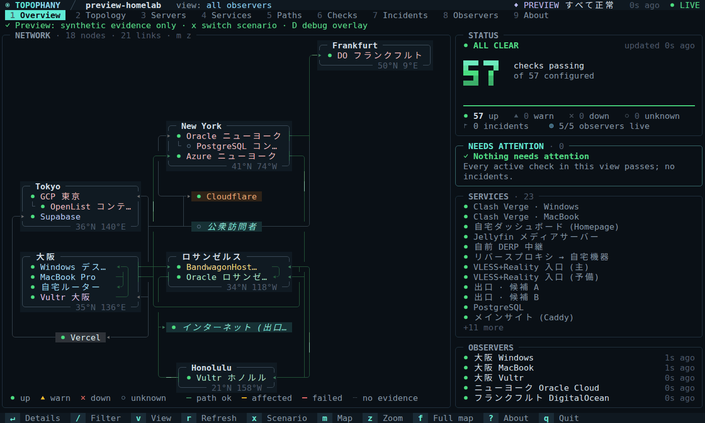
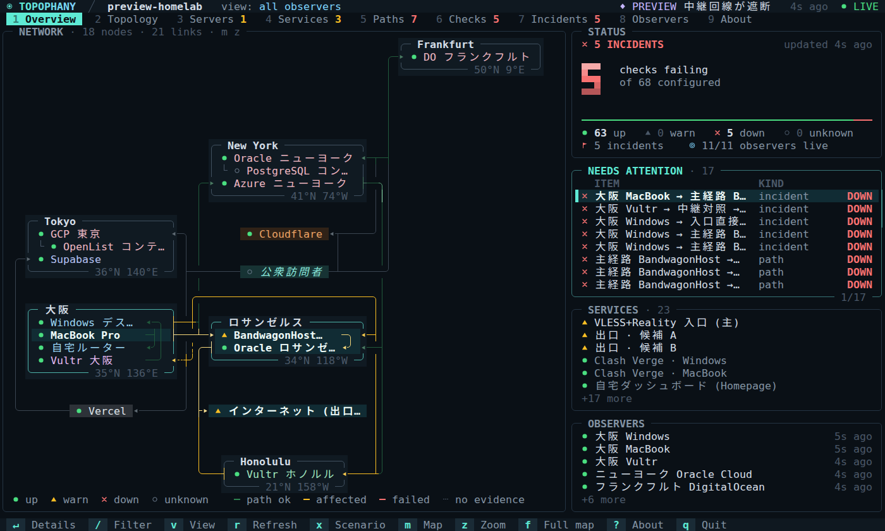
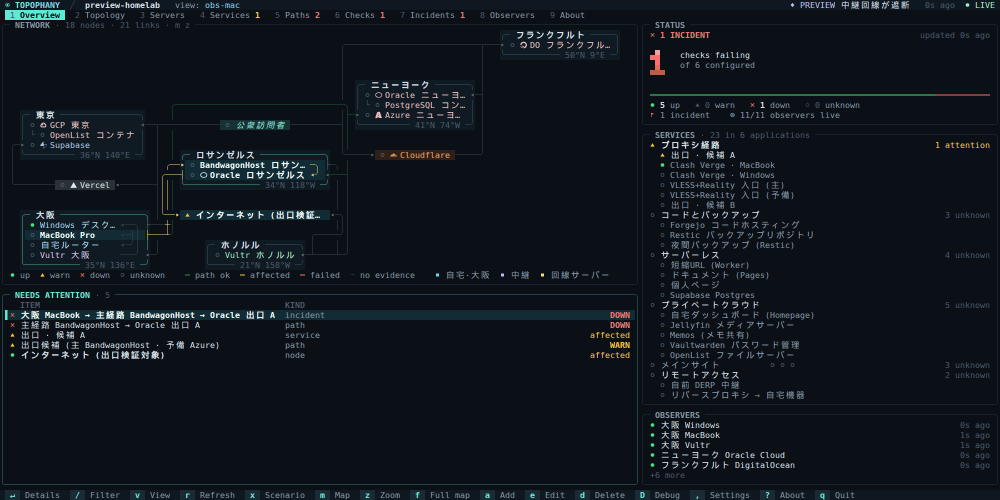

<h1 align="center">
  
</h1>

<p align="center"><b>どこから、どの経路で、何に届いたのか — そして、何を根拠に。</b></p>

<p align="center">
  <a href="https://topophany.com/ja/"><b>topophany.com</b></a> ·
  <a href="https://github.com/WhitenWhiten/topophany/releases">ダウンロード</a> ·
  <a href="docs/GUIDE.md">ユーザーガイド (英語)</a>
</p>

<p align="center"><sub><a href="README.md">English</a> · <b>日本語</b> · <a href="README.zh.md">简体中文</a></sub></p>

<p align="center">
  <a href="https://github.com/WhitenWhiten/topophany/actions/workflows/ci.yml"></a>
  <a href="https://pkg.go.dev/github.com/WhitenWhiten/topophany"></a>
  <a href="LICENSE"></a>
  <a href="https://linux.do"></a>
</p>

**Topophany** は、ネットワーク全体をひとつの画面に描き出します。どんなマシンがどこにあり、互いをどの経路で結び、その上で何のサービスが動いているのか。ワーカーが実際につなぐ場所 (自宅、オフィス、海外の VPS) からチェックし、ターミナル UI が、何が壊れているのか、それがどこから見えたのか、そして根拠は何かを示します。すべてはセルフホストの Go バイナリ 1 つ、`topo` で動きます。

<p align="center">
  
  <br><sub><code>topo preview --lang ja</code> で <code>x</code> を押すと、自宅からロサンゼルスの回線サーバーへの接続が遮断されます。問題を選ぶとその経路が浮かび上がり、<code>Enter</code> で根拠を表示します。続いて地図が全画面に広がり (<code>f</code>)、場所のカードが点に切り替わります (<code>p</code>)。</sub>
</p>

## Topophany を選ぶ理由

- **壊れたことだけでなく、どこで壊れたかを。** チェックはすべて、名前を付けた観測点から行います。大阪からは届かないのにニューヨークからは届くなら、それは大阪からの経路の障害です。Topophany はサーバーダウンと決めつけず、そのとおりに報告します。
- **色ではなく根拠を。** 健全性、根拠の出どころ、鮮度はそれぞれ別のフィールドです。通ったチェックなしに緑になるものはなく、誰もチェックしていないサービスは `unknown` のまま、キャッシュの表示はキャッシュだと明示されます。
- **ネットワークのメモ帳に。** 何がどこで動き、各マシンにどう届き、各経路がどのプロキシチェーンを通るのか。レビュー済みの JSON ファイル 1 つに、ノートや手順書と一緒にまとめられます。あなたも、エージェントも、そして監視そのものも、このファイルを読みます。
- **眺めていたくなる画面。** 点字で描く世界地図、場所の並びを保つ模式図、ネットワークグラフ、サーバーごとのカード。サービスは所属するアプリケーションごとにまとまります。どのターミナルでも動き、マウスにも対応します。
- **バイナリ 1 つ、ほかは何も要らない。** CGO も、データベースのデーモンも、Node.js も不要で、外部の Go モジュールはゼロです。

<p align="center">
  
  <br><sub>障害をシミュレートしている Overview。<code>topo preview --lang ja --scenario 1</code> より。</sub>
</p>

## 1 分で試す

[リリースページ](https://github.com/WhitenWhiten/topophany/releases) (Linux、macOS、Windows · amd64、arm64) からインストールするか、Go 1.26.9 以降で:

```sh
go install github.com/WhitenWhiten/topophany/cmd/topo@latest
```

準備なしで、合成の根拠を使って UI 全体を見られます。`x` を押して、何かを壊してみてください。組み込みのネットワークとシナリオは日本語・英語・中国語で書かれていてロケールに従い、`--lang ja` で選べます:

```sh
topo preview
```

デモ用のトポロジーと新しい認証情報で、本物のコレクターを手元で動かします:

```sh
topo init --dir ./demo
topo serve --config ./demo/topology.json --auth ./demo/auth.json \
  --data ./demo/collector-data --observer demo

# in another terminal
topo --credentials ./demo/credentials.json
```

## エージェントに書かせる

監視でいちばん手間がかかるのは、何を監視するかを書き起こすことです。そしてそれは、コーディングエージェントが得意とする仕事でもあります。普段使っているエージェント (Claude Code、Codex、Gemini CLI、Cursor など、コマンドを実行できるもの) に、マシンが既に持っている情報を読ませてトポロジーを書かせましょう。エージェントは `topo validate` で自分の仕事を確かめ、あなたは何かを動かす前に `topo preview` で仕上がりを確認できます。たとえば、こう頼みます:

> 私のネットワークを Topophany のトポロジーとして `topology.json` に書いてください。形式は `topo preview --print-topology` の出力と、github.com/WhitenWhiten/topophany の docs/REFERENCE.md を参考にしてください。SSH の設定、`tailscale status`、見つかる Compose ファイルとリバースプロキシの設定を読み、各マシンについて場所、動いているサービス、サービスが属するアプリケーション、待ち受けているアドレスを宣言し、ワーカーを動かす予定のマシンからのチェックを加え、分かったことはそれぞれのマシンの notes に書いてください。秘密情報はファイルに書かないでください。`topo validate --config topology.json` が通るまで直し、最後に、確かめたことと推測したことを分けて教えてください。

書き上がったら、あなたとエージェントの両方で使い続けられます:

- **ネットワークのメモとして。** 何がどこで動き、各マシンにどう届くのかが、ノートや手順書と一緒にこのファイルにまとまります。エージェントは手を動かす前にこれを読み、あなたはその変更をコードと同じように差分でレビューします。`topo edit` を使えば TUI でも編集できます。
- **すぐ引ける窓口として。** `topo status`、`topo show`、`topo history` が 1 行の文字で、`--json` を付ければ JSON で答えます。いま何かおかしいか、あのサーバーで何が動いているか、あのチェックが夜のあいだどうだったか。コレクターを動かす前でも、`topo preview --config topology.json show servers` ならファイルだけから答えます。

## しくみ

```text
  WORKERS                          COLLECTORS                  CLIENTS
  measure from where they are      keep the evidence           read it

  topo worker   (home laptop)  ─┬─▶  topo serve  (A)  ─┬─▶  topo          the TUI
  topo worker   (Tokyo server) ─┴─▶  topo serve  (B)  ─┴─▶  topo status   for scripts and agents
```

- **ワーカー**は、レビュー済みのローカルのトポロジーファイルにあるチェックを実行し、観測結果を 1 つまたは 2 つのコレクターに届けます。ネットワークが落ちている間はディスクにためておきます。
- **コレクター**は追記専用のジャーナルを持ち (ACK の前に fsync)、健全性、インシデント、鮮度を導きます。各インシデントを発生から終了まで、各チェックの調子を数か月にわたって記憶し、インシデントを Webhook (ntfy、Slack、Discord、JSON) に送ることも、自分でチェックを実行することもできます。
- **クライアント**は読むだけです。TUI を閉じても監視は止まらず、Topophany がルート、プロキシ、サービスを変更することは一切ありません。

| コマンド | 役割 |
|---|---|
| `topo` | 保存した認証情報でリモートのコレクターの TUI を開く |
| `topo status` / `topo show TAB [ID]` | TUI が示す内容をテキストまたは `--json` で出力する。`status` は終了ステータスでも答える |
| `topo login` | コレクターへの接続を保存し、検証する |
| `topo serve` | コレクターを動かす。自前のチェックも実行できる |
| `topo worker` | このマシンからチェックを実行して報告する |
| `topo edit` / `topo validate` | トポロジーファイルを TUI で編集する / 検査してリビジョンとコントラクトを出力する |
| `topo preview` | 合成の根拠で TUI を開く |
| `topo init` | 新しい認証情報でローカルのデモを作る |

すべてのコマンドは `topo help` で確認できます。

## 自分のネットワークを監視する

1. **書き起こす。** トポロジーは、ノード、リンク、エンドポイント、サービス、経路、観測点、チェックを並べた JSON です。上のようにエージェントに書かせるか、[`examples/homelab.json`](examples/homelab.json) から始めて `topo edit --config topology.json` で編集します。どちらの場合も `topo validate` で検査します。
2. **コレクターを動かす。** 機器から届く場所で、TLS を有効にして：`topo serve --config topology.json --auth auth.json --data collector-data --listen 0.0.0.0:7447 --tls-cert server.pem --tls-key server-key.pem`
3. **ワーカーを動かす。** 計測の起点にしたいすべてのマシンで：`topo worker --config topology.json --observer <id> --credentials worker-credentials.json --data worker-data`
4. **どこからでも見る。** `topo login --server https://your-collector:7447 --project <name>` のあとは `topo` だけです。

[運用ガイド](docs/OPERATIONS.md) (英語) ではデュアルコレクター、systemd ユニット、各種上限を、[セキュリティモデル](docs/SECURITY.md) (英語) ではトークンと通信を扱います。

## 計測できるもの

- **ネイティブプローブ:** HTTP (ステータス、本文、ヘッダー、出口 IP)、TCP、証明書を検証する TLS、SSH バナー、DNS A/AAAA、UDP エコー、ICMP (IPv4)。
- **ホストリソース（Linux / macOS）:** CPU、メモリ、ファイルシステム容量と inode、プロセス数、指定プロセスの RSS。リソースしきい値とプロセス数の検証にも対応。[`examples/host-resources.json`](examples/host-resources.json) を参照。
- **プロキシチェーン:** HTTP CONNECT、HTTPS CONNECT、SOCKS5、OpenSSH `-W` を、複数ホップにわたって連結。
- **読み取り専用アダプター:** Mihomo、Tailscale、WireGuard。
- **エッジとプラットフォーム:** Cloudflare (Workers と Pages を含む)、Vercel、Supabase。エッジからの応答が証明するのはエッジであって、その背後のオリジンではありません。

## ターミナル UI

9 つのタブ：**Overview**、**Topology** (仮想地図、地図、ネットワークの 3 つのマップ)、**Servers**、**Services**、**Paths**、**Checks**、**Incidents**、**Observers**、**About**。サービスは宣言したアプリケーションごとに、チェックは確かめる対象のサービスごとにまとまり、`b` でアプリケーション、環境、ホスト別に見て回れます。

<p align="center">
  
  <br><sub>大阪からはダウン、ニューヨークからは正常。各観測点は見えるものだけを報告します (<code>v</code>)。続いて 3 つのマップ (<code>m</code>)：仮想地図、地図、ネットワーク。地図は全画面に広がり (<code>f</code>)、場所のカードが点に切り替わります (<code>p</code>)。</sub>
</p>

| キー | |
|---|---|
| `1`–`9`、`Tab` | タブを切り替える |
| `j` / `k`、矢印キー | リストを移動する |
| `Enter` | 選んだ行の根拠を表示する |
| `/` | 絞り込む |
| `v` | 視点にする観測点を切り替える |
| `m` / `z` / `f` / `p` | マップを切り替える / ズームする / マップだけを表示する / 地図は点と破線だけにする |
| `s` | サーバーカードを同じ大きさに揃える |
| `b` | サービスとチェックをアプリケーション、環境、ホスト別に見る |
| `q` | 終了する |

マウスも使えます。色は truecolor、256 色、`NO_COLOR` の端末に合わせて変わります。[ユーザーガイド](docs/GUIDE.md) (英語) では、すべてのタブとマップ、そして `topo status`、`topo show`、`topo history` でスクリプトやエージェントからすべてを読み取る方法を説明しています。

## ドキュメント

ドキュメントは英語です。

| | |
|---|---|
| [ユーザーガイド](docs/GUIDE.md) | TUI、編集、プレビューモード、セマンティクス、プローブ、複数拠点での運用 |
| [設定と API のリファレンス](docs/REFERENCE.md) | すべてのエンティティ、プローブのパラメーター、API エンドポイント |
| [運用](docs/OPERATIONS.md) | デュアルコレクター、ストレージ、復旧、リソースの上限 |
| [セキュリティモデル](docs/SECURITY.md) | 認証情報、通信、権限の境界 ([レビュー](docs/SECURITY-REVIEW-2026-10-14.md)) |
| [シナリオ](docs/SCENARIOS.md) · [受け入れ](docs/ACCEPTANCE.md) | テストが証明すること、実機での確認が必要なこと |
| [変更履歴](CHANGELOG.md) | リリースの履歴 |

## リポジトリの構成

```text
cmd/topo        the single binary
internal/       model, config, probes, scheduler, journal, engine, API, client, outbox, view, TUI, preview
examples/       sample topologies and credential templates
deploy/         hardened systemd units for the collector and the worker
docs/           guides, reference and verification records
scripts/        acceptance and verification suites
site/           the topophany.com homepage (a separate module, not part of go install)
```

## 開発

```sh
go test ./...                # unit and integration tests
go test -race ./...
python3 scripts/verify.py    # the full acceptance suite (Linux, Go, Python 3)
make site                    # re-record the homepage's TUI replays and rewrite its pages
```

ビルドにモジュールのダウンロードは不要です。変更を送る前に [CONTRIBUTING.md](CONTRIBUTING.md) と [行動規範](CODE_OF_CONDUCT.md) を読み、脆弱性は [SECURITY.md](SECURITY.md) にあるとおり非公開で報告してください。

## ライセンス

[MIT](LICENSE)
