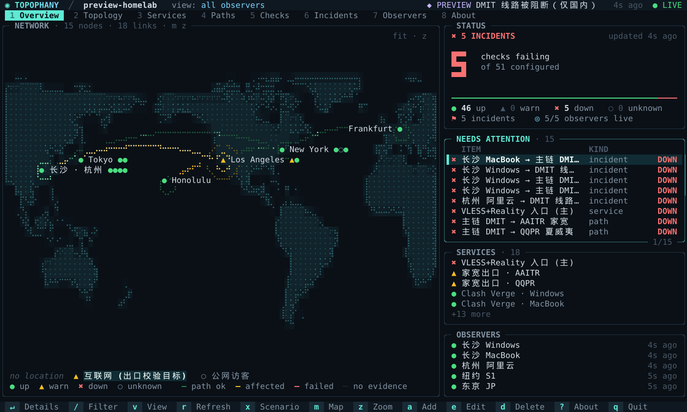
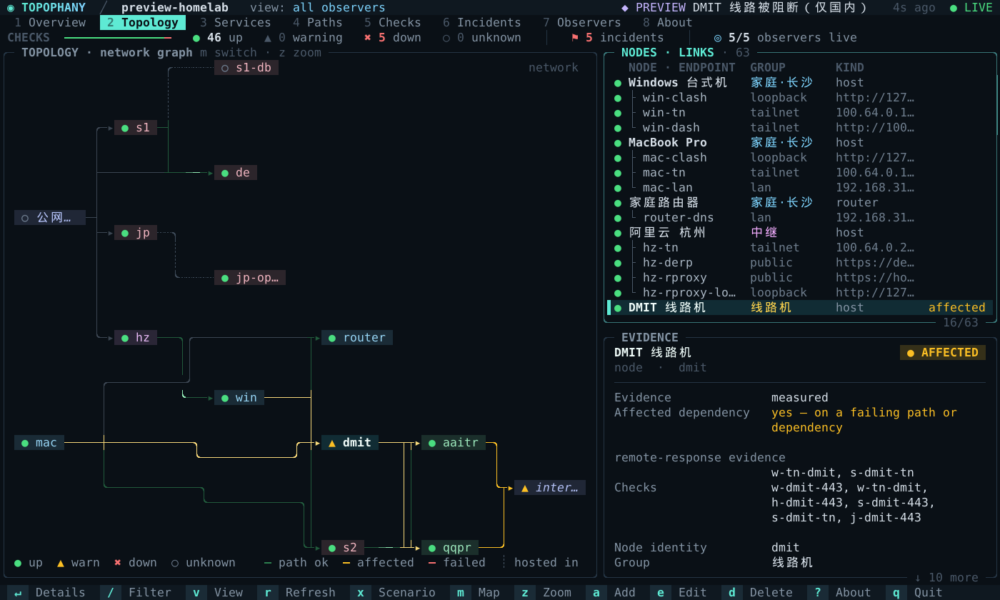
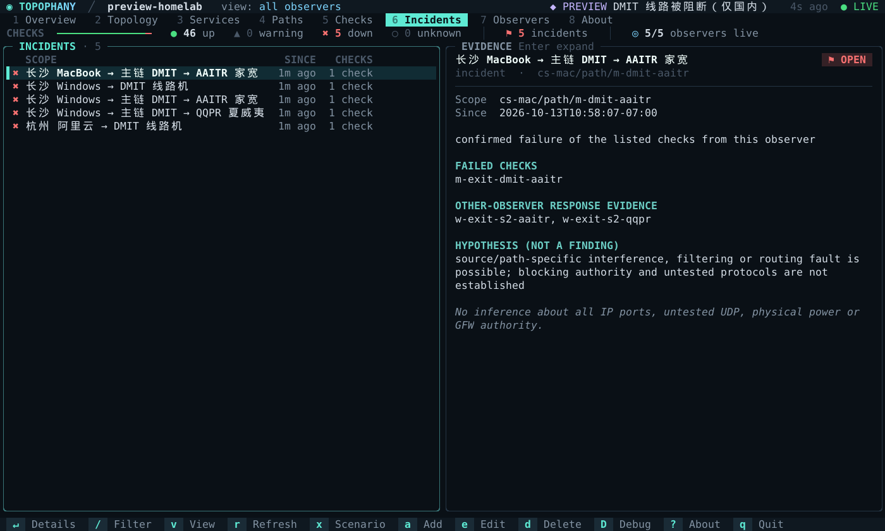

<h1 align="center">
  
</h1>

<p align="center"><b>From where, via which path, reaching what — and on what evidence.</b></p>

<p align="center">
  <a href="https://github.com/WhitenWhiten/topophany/actions/workflows/ci.yml"></a>
  <a href="https://pkg.go.dev/github.com/WhitenWhiten/topophany"></a>
  <a href="LICENSE"></a>
</p>

Topophany is an open-source, self-hosted network topology and service availability monitoring system written in Go. The `topo` binary functions as a remote TUI client, an ingestion collector server, or a scoped observation worker. Closing the client does not interrupt background monitoring.

- **Evidence, not colors.** Health, evidence source and freshness are separate fields. Nothing turns green without a passing check, an unmonitored service stays `unknown`, and a cached view says so.
- **Vantage points are explicit.** Each observer measures from where it actually is; a failure seen from home is not reported as a server outage.
- **A terminal UI you can read at a glance.** The Overview answers *is anything wrong, and where?* — a verdict, a map of every place and path, and the short list of what needs attention.
- **One binary, no dependencies.** No CGO, no database daemon, no Node.js, and zero external Go modules.

<p align="center">
  
  <br><sub>The Overview during a simulated outage, from <code>topo preview --scenario 1</code>.</sub>
</p>

The official project name is **Topophany**, and the CLI command is **`topo`**. This codebase is a clean-room, verified 0.1.0 release. It contains no production addresses, external network memos, or live credentials.

## Installation

Download a prebuilt archive for Linux, macOS or Windows from the
[releases page](https://github.com/WhitenWhiten/topophany/releases), or install from source:

```sh
go install github.com/WhitenWhiten/topophany/cmd/topo@latest
```

## Quick Start

Requires Go 1.26.9 or newer (with standard library security patches). See [docs/SECURITY-REVIEW-2026-10-14.md](docs/SECURITY-REVIEW-2026-10-14.md) for the security review. **Zero external Go runtime dependencies, no CGO, no Node.js, and no external database daemon.** When a compliant Go toolchain is installed, building and running basic tests requires no module downloads.

```sh
go test ./...
go build -trimpath -o topo ./cmd/topo

./topo init --dir ./demo
./topo serve --config ./demo/topology.json --auth ./demo/auth.json \
  --data ./demo/collector-data --observer demo
```

In another terminal:

```sh
./topo --credentials ./demo/credentials.json
```

To see the interface without deploying anything, run `./topo preview`: the full TUI on a built-in topology driven by synthetic evidence (press `x` to switch failure scenarios).

The default listener is `127.0.0.1:7447`. The demo configuration probes only this loopback API without reaching external targets; the registered workstation and notes-only service deliberately remain unmonitored (`unknown`), never feigning completion. The `init` command generates high-entropy random credentials on each invocation and refuses to overwrite existing directories.

On Linux and macOS, add the compiled `topo` binary to your `PATH`. On Windows, build as `topo.exe`. For detailed options, run `topo help`, `topo serve --help`, etc.

## Day-to-Day Usage: Just Run `topo`

Deploy the collector server remotely and obtain a **viewer** token. Verify the expected project identity upon initial login:

```sh
topo login --server https://monitor.example.invalid:7447 --project homelab
```

Terminal token entry does not echo characters. For automated scripts, use `--token-stdin`; avoid persisting tokens in CLI arguments, screenshots, or shell history.

```sh
# token.txt must be a private file managed by the user; no default tokens exist.
topo login --server https://monitor.example.invalid:7447 \
  --project homelab --token-stdin < token.txt

topo                            # Connects to remote collector using saved credentials and opens TUI
topo --observer observer-local  # Explicitly select observation vantage point
topo --json                     # Emits a structured snapshot from the API without opening the terminal UI
topo --credential TOKEN         # Explicit, transient credential override (visible in local process table)
```

Credentials are saved by default to the operating system user configuration path under `topophany/credentials.json` (`$XDG_CONFIG_HOME` or `~/.config` on Linux; `~/Library/Application Support` on macOS; `%APPDATA%` on Windows). The `--credentials` flag overrides the file path, and `--profile` switches between saved project profiles. On Windows, files inherit ACLs from the user profile directory; **the application does not treat POSIX 0600 as a substitute for Windows ACLs** (verify per [docs/SECURITY.md](docs/SECURITY.md)).

Custom or self-signed certificates require `--ca-file /path/to/ca.pem` rather than disabling certificate verification. Except for literal loopback addresses, plaintext HTTP connections are rejected by default. Use `--allow-insecure` only when plaintext transport across a secure private tunnel is explicitly intended.

## Terminal Interface

The TUI is built to answer one question before anything is read: *is anything wrong, and where?*

- **Overview** — a verdict headline with a big failure count, a map of every node and link, the list of what needs attention (incidents, failing paths and services, silent observers), a service matrix, and how fresh each observer is. Selecting an item lights its whole route on the map. On wide terminals the map sits beside the cards; smaller terminals stack them.
- **Topology** — the node → endpoint → link hierarchy beside the map, with the evidence for the selected entity underneath.
- **Services, Paths, Checks, Incidents, Observers** — aligned tables. The state column stays empty for healthy rows, so problems are the only lit words; `Enter` expands the evidence behind a row.
- **About** — a one-bit dithered globe on which the places you declared are the only lights. The mouse wheel spins it.

<table>
  <tr>
    <td width="50%"></td>
    <td width="50%"></td>
  </tr>
  <tr>
    <td align="center"><sub>Topology as a network graph</sub></td>
    <td align="center"><sub>An incident and its evidence</sub></td>
  </tr>
</table>

Press `m` to switch the map between two modes:

- **geo** — a braille dot-matrix world map (2×4 dots per cell, Natural Earth 1:110m land) that places nodes by their declared `location`, never by IP address. Nodes at one place are clustered into a single site with one marker per node; each pair of sites gets one arc. An arc is green when its link is measured up or a declared path over it succeeds, amber when it is degraded or on a failing path, red when it fails, and grey when nothing has measured it; healthy arcs stay faint so that problems stand out, and hops implied only by a declared path are dashed. Flow pulses run only along links with positive evidence, and sites with a problem ripple. Nodes without coordinates wait in a "no location" tray. The view crosses the antimeridian on the shorter side, and `z` cycles between fitting every site, focusing the selection, and the whole world.
- **network** — a left-to-right layered graph drawn as a schematic: sources on the left, each link one column further, long links routed around the nodes in between. Nodes are chips colored by group; wires leave a chip to the right and turn once before the next column, wires from one source share a track, crossings are bridged, and "hosted in" relations are dotted. Selecting a path or incident highlights its hops.

| Keys | |
|---|---|
| `1`–`8`, `Tab` / `Shift-Tab`, `h` / `l` | switch tabs (`?` toggles About) |
| `j` / `k`, arrows, `PgUp` / `PgDn`, `g` / `G` | move through the list |
| `Enter` | expand evidence for the selected row |
| `/` | filter rows |
| `v` | cycle observer vantage points |
| `m` / `z` | map mode / map zoom |
| `r` | refresh now |
| `D` | debug overlay: frame time, bytes written, map geometry |
| `q` | quit |

Tabs, rows, footer buttons, map sites, menus and modal buttons all respond to the mouse, and the wheel scrolls lists.

The UI paints its own dark ink background, so contrast is the same on dark, light and tinted terminal themes; set `TOPO_BACKGROUND=terminal` to keep your terminal's background instead. Truecolor terminals get 24-bit color and others fall back to xterm-256; under `NO_COLOR` every escape for color is dropped and selection switches to plain glyphs such as `›` and `[a]`. Only the cells and colors that change are written to the terminal. Wide characters and full UTF-8 are supported; the recommended geometry is at least 100×28 (minimum 30×10), and the layouts adapt to whatever space there is.

### Editing Topology

The remote TUI is read-only: the collector server **deliberately provides no remote configuration mutation API**. Pressing `a`, `e`, or `d` prompts the user to invoke the local editor. Topology edits operate on reviewed local files:

```sh
topo edit --config topology.json            # Creates file upon first save if absent
topo edit --config new.json --project lab   # Sets project ID for new configuration files
```

In the editor, `a` opens the Add menu (Nodes, Links, Endpoints, Services, Observers, Paths, Checks; defaults to the highlighted entity type), `e` edits the selected item, `d` deletes an item (refused with an explanatory error if still referenced), `u` undoes changes, `Ctrl-S` saves, and `q` prompts for confirmation if unsaved changes exist. Every edit triggers a complete `topo validate` pass; validation failures remain in the form with error details. In the Node form, entering recognized city names in the Place field autocompletes latitude and longitude coordinates. Saving is atomic, preserving file permissions (`0600` for new files) and updating the revision hash. Collectors and workers must be gracefully restarted for changes to take effect. Unmodeled fields (such as proxy chains in paths) are preserved as-is.

### Preview Mode (Synthetic Evidence)

`topo preview` opens the TUI without connecting to a collector, driving layout and rendering with a rich built-in topology and synthetic observation history:

```sh
topo preview                         # Built-in topology: local site nodes, cloud relay, primary/backup transit gateways, dual egress nodes, application clusters, and regional edge nodes
topo preview --scenario 2            # Opens in the steady state of a specific scenario (index toggled by x in TUI)
topo preview --config topology.json  # Runs synthetic scenarios against your own topology file (non-matching scenarios hidden automatically)
topo preview --json                  # Emits a synthetic snapshot JSON without entering TUI
topo preview --print-topology        # Dumps the built-in topology JSON to stdout for customization via topo edit
```

In the built-in preview topology: local workstations connect across primary transit gateways to regional egress nodes for external verification; a backup transit gateway serves as failover; Tailscale connects nodes across locations; and a central cloud relay provides DERP relaying and reverse proxying. Press `x` to switch scenarios (transit filtering, host downtime, egress IP drift, local uplink failure, maintenance, clock skew, collector unreachable, etc.). CLI-specified scenarios initialize in an established state; switching scenarios inside the TUI begins at the current time, applying confirmation thresholds and expiration rules in real time. Evidence is derived from simulated observations through the state engine rather than hardcoded UI colors. Press `D` to toggle debug overlays (frame render duration, redraw bytes, map node count). The topology in preview mode is read-only.

When collectors are unreachable, cached data is retained but items transition to `unknown` and are marked CACHED. Switching to a backup collector never silently changes the observer vantage point. The TUI queries the HTTP API every 3 seconds (preview mode regenerates synthetic snapshots every second); SSE and browser-based frontends are not implemented.

## Core Semantics

| Observed Fact | Dashboard Behavior |
|---|---|
| Local connection to primary transit fails on probed port while cloud relay comparison succeeds | Local path marked abnormal; alternate vantage point retains success evidence; not counted as physical server downtime |
| TCP connection establishment (accept) succeeds | Confirms only connection establishment; insufficient to verify application protocol, proxy authentication, or full path health |
| Transport fallback succeeds while proxy authentication fails | Results reported separately; standard web fallback does not prove proxy tunnel availability |
| Controller reports routing group switched to backup path | Displays runtime routing choice; does not declare business restoration without end-to-end check |
| Request succeeds but egress IP violates policy | Reports `policy` outcome; reachability and egress policy constraints evaluated separately |
| Executor stops reporting | That observer perspective gradually transitions to stale / unknown; does not mark all remote assets down |
| Registered but unmonitored service | Marked "registered, not monitored"; does not default to green |
| Primary path fails while candidate path succeeds | Candidate reported available, redundancy degraded; does not automatically assert production traffic has switched |

Health outcomes, evidence sources, and freshness are distinct fields. The Services tab displays configured access check results, not unmeasured process internals. Dependency propagation flags affected scope without fabricating downstream downtime evidence. Incident analysis does not make inferences about upstream middlebox enforcement, broad IP blocking, untested UDP ports, or physical server power status.

## Probes and Protocol Adapters

Native probes include HTTP assertions, TCP, TLS with certificate validation, SSH banner, DNS A/AAAA (UDP with truncated TCP fallback), UDP echo with random nonces, and IPv4 ICMP. HTTP probes support expected status codes, substring/regex body matching, response header assertions, and egress IP/CIDR constraints; they can pin dial IPs while preserving Host/SNI, or bind to local source IPs. Insufficient ICMP permissions are classified as monitor configuration errors rather than target outages.

Explicit outbound proxy chains support multi-hop combinations of HTTP CONNECT, HTTPS CONNECT, SOCKS5, and strict OpenSSH `-W` stream forwarding as an initial hop. SOCKS5 passes domain names to the proxy for remote resolution, never falling back to direct connections on failure. OpenSSH adapters require an installed `ssh` binary, dedicated keys, and pre-verified `known_hosts`; they reject unverified host keys, interactive passwords, and arbitrary shell commands.

Layered proxy protocols (such as Reality, XHTTP, or VLESS) are hosted by external proxy engines (e.g. Mihomo). Configure dedicated loopback SOCKS/CONNECT listeners for candidates, then have Topophany verify end-to-end requests; the tool never mutates production routing groups, restarts proxy cores, or creates unmanaged production listeners. Production TUN interfaces, explicit production proxies, and isolated test cores must be registered under separate check scopes.

The Mihomo adapter reads only `/configs`, `/proxies`, and `/providers/proxies`, recursively expands `dialer-proxy` chains, and records mode, TUN status, selected nodes, provider names/order, and test URLs. It is forbidden from invoking latency measurement endpoints that could influence routing decisions, and never queries full client connection tables. Parameter consistency cannot be verified solely by node name, and sequential API reads do not form an atomic snapshot.

Tailscale status is queried via local `tailscale status --json`; WireGuard reads handshakes and byte counters via `wg show <interface> dump` while stripping private keys. Both serve as auxiliary telemetry and do not substitute for end-to-end service checks; idle states or older handshakes do not immediately declare outages. Missing host executables report monitor-side errors.

## Multi-Location and Dual Collector Deployment

The central server can execute its own baseline checks: `serve --observer observer-cloud-relay`. To measure local residential paths toward remote targets, run a worker on the local node: `worker --observer observer-local-workstation`; remote servers cannot substitute for local observation. Workers execute only locally reviewed configurations; collectors cannot dispatch arbitrary probe targets or commands to workers.

```sh
# Deploy identical reviewed topology.json configurations to respective machines.
topo serve --config topology.json --auth auth.json --data collector-a \
  --listen 0.0.0.0:7447 --tls-cert server.pem --tls-key server-key.pem

topo worker --config topology.json --observer observer-local-workstation \
  --credentials worker-credentials.json --data worker-local
```

Configure two collector endpoints in the worker's credential profile under `servers`. The worker dispatches to both independently, buffering in a local bounded outbox during network partitions. Each collector maintains independent storage; never share database or journal directories across NFS/SMB mounts. Client credentials can also configure multiple endpoints for read-only failover. **Viewer and worker roles must use distinct tokens.**

Collectors must share matching project identities and normalized configuration revision hashes. Mismatched configuration revisions are rejected and quarantined, preventing stale measurement definitions from corrupting active metrics. Data is fsynced prior to returning delivery ACKs; retransmitted records retain original sample timestamps; duplicate deliveries are deduplicated by observation ID. Permanently rejected records are retained for administrative review under hard storage quotas; when quotas are reached, probing stops with an error rather than silently discarding evidence.

This architecture provides multi-replica availability for observations and dashboards, not a distributed consensus cluster for administrative mutations. There is no automated leader election and no remote management takeover. Shared upstream networks, common egress gateways, and local worker host failures remain common points of failure. For details, see [Deployment and Operations](docs/OPERATIONS.md).

## Configuration, Resources, and Architecture

Configurations use strict JSON rather than maintaining parallel YAML and database copies. Running `topo validate --config topology.json` validates references, dependency loops, execution scopes, timing budgets, and probe compatibility, emitting a normalized summary. Configuration updates require a graceful restart; implicit hot-reloading and remote mutation APIs are not provided.

`examples/homelab.json` provides an anonymized modeling template with **all checks paused by default**, using documentation IP ranges and `.invalid` domain names. Populate actual endpoints, dedicated listeners, credential environment variables, and observer definitions before enabling checks individually. `examples/minimal.json` provides a loopback demonstration topology matching `init` output without tokens.

This version uses standard library ANSI escape sequences for the TUI and a local append-only log with checkpoints, **without Bubble Tea or SQLite**. This deliberate architectural decision ensures the entire codebase builds without external dependencies. Resource usage is strictly bounded: default raw history retains up to 20,000 records or 24 hours, storing 40 trailing state samples per check with bounded deduplication receipts; worker outbox defaults to 32 MiB. Operators requiring larger scale should evaluate retention and snapshot strategies rather than continuously increasing memory ceilings.

```text
cmd/topo           Single binary entrypoint
internal/model     Shared data models and API contracts
internal/config    Strict configuration, validation, revision hashing, and redaction
internal/probe     Native protocols, proxy dialing, and local tool adapters
internal/runner    Bounded, staggered, target-exclusive probe scheduler
internal/store     Single-writer append log, checkpoints, recovery, and deduplication
internal/engine    Freshness tracking, evidence aggregation, and dependency state derivation
internal/api       Collector HTTP API and scoped token authorization
internal/client    Credentials, project identity validation, and read-only failover
internal/outbox    Durable dual-dispatch queue, backoff retries, and quarantine handling
internal/tui       Native terminal handling, keyboard/mouse input, 8 tabs, dot-matrix canvas,
                   geo/network topology maps, About globe animation, and local editor
internal/preview    Built-in rich topology and synthetic scenarios for offline TUI preview
internal/app        CLI subcommand dispatch and wiring
scripts            Automated acceptance, verification, and process/PTY integration tests
deploy             Hardened systemd unit templates for collector and worker
examples           Sample topologies and credential file templates
docs               Reference, operations, security model, scenarios, and verification records
```

Service management boundaries display deployment nodes, ingress endpoints, notes, and runbooks. Remediation actions are left to authorized external operations tooling. **This release contains no remote shell, arbitrary script execution, or automated remediation APIs**; it is not a privileged backdoor disguised as an agent.

## Testing and Verification

```sh
go vet ./...
go test -count=1 ./...
go test -race -count=1 ./...
go test -count=3 ./...
python3 scripts/verify.py             # Complete acceptance suite (Linux + Go + Python 3)
```

Test suites cover real local HTTP/TLS servers, DNS UDP/TCP resolution, UDP nonce reflection, ICMP packet encoding/decoding and permissions (raw socket tests run only when privileges are available), CONNECT->SOCKS5->CONNECT 3-hop proxies, configuration/credential boundaries, journal and outbox crash recovery/deduplication, structured fixtures for external adapters, Linux PTY and independent collector/worker/TUI processes, and time-bounded fuzzing.

`docs/SCENARIOS.md` maps design scenarios to automated test cases without fabricating observations for unmonitored infrastructure. `scripts/verify.py` writes command logs, exit codes, test events, code coverage, fuzz results, cross-compilation builds, and live process acceptance logs to `.verify-build/verification/` (CI publishes them as the `verification` workflow artifact). When reviewing results, distinguish between top-level test functions, subtest events, and fuzz seeds; these are not conflated into independent feature scenarios.

Production Windows TUN drivers, live third-party proxy core configurations, external proxy providers, live Tailscale/WireGuard tunnels, OpenSSH cryptographic handshakes, and live intermittent transit route issues were not executed on end-user hardware. Local protocol integration and structured fixtures verify software mechanics; cross-compilation passes do not substitute for native OS runtime acceptance. Prior to production deployment, complete the [Hardware Acceptance Checklist](docs/ACCEPTANCE.md).

## Contributing

Contributions are welcome — read the [Contribution Guidelines](CONTRIBUTING.md) and [Code of Conduct](CODE_OF_CONDUCT.md) first. Report vulnerabilities privately as described in the [Security Policy](SECURITY.md); see also [Security Boundaries](docs/SECURITY.md) and the [Configuration and API Reference](docs/REFERENCE.md). Release history is in the [Changelog](CHANGELOG.md).

## License

Topophany is licensed under the [MIT License](LICENSE).
