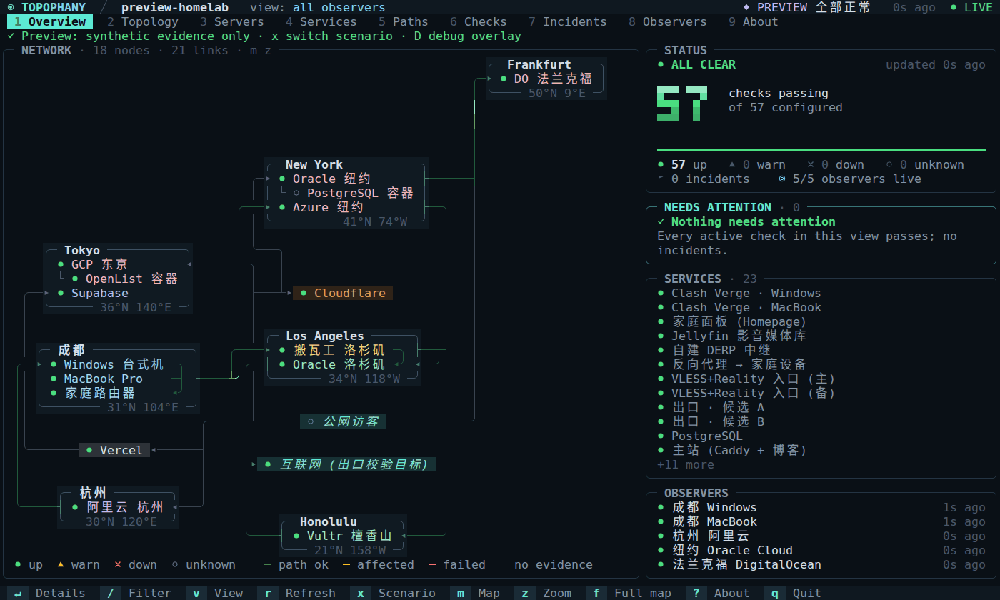
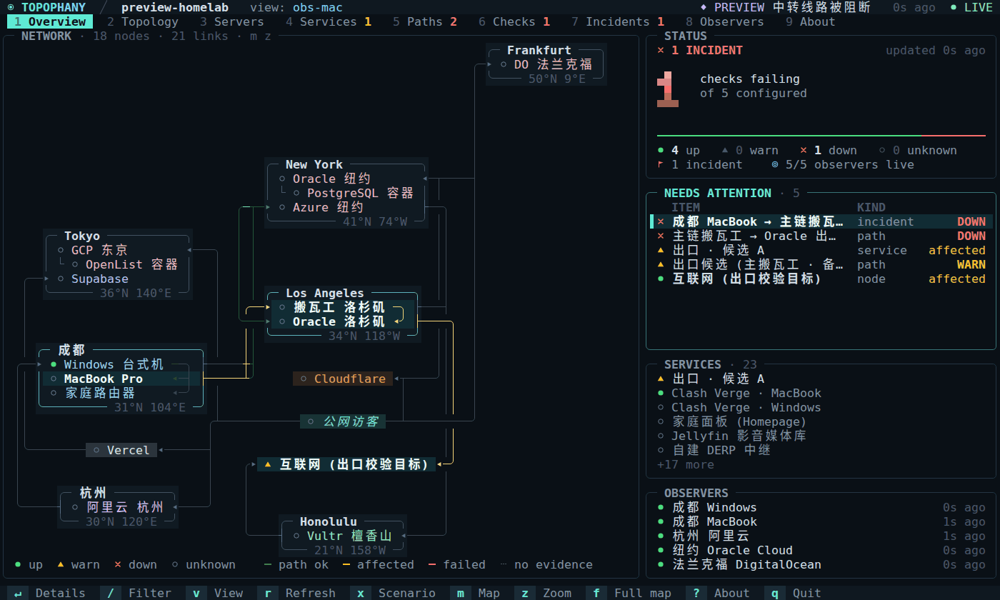

<h1 align="center">
  
</h1>

<p align="center"><b>从哪里出发，经由哪条路径，抵达了什么——依据又是什么。</b></p>

<p align="center">
  <a href="https://topophany.com/zh/demo/"></a>
</p>

<p align="center">
  <a href="https://topophany.com/zh/"><b>topophany.com</b></a> ·
  <a href="https://github.com/WhitenWhiten/topophany/releases">下载</a> ·
  <a href="docs/GUIDE.md">用户指南（英文）</a>
</p>

<p align="center"><sub><a href="README.md">English</a> · <a href="README.ja.md">日本語</a> · <b>简体中文</b></sub></p>

<p align="center">
  <a href="https://github.com/WhitenWhiten/topophany/actions/workflows/ci.yml"></a>
  <a href="https://pkg.go.dev/github.com/WhitenWhiten/topophany"></a>
  <a href="LICENSE"></a>
  <a href="https://linux.do"></a>
</p>

**Topophany** 把整张网络摆在一块屏幕上：有哪些机器、各在何处，彼此之间走哪条路，上面跑着哪些服务。worker 从你真正上网的地方（家里、公司、海外的 VPS）发起检查，终端界面告诉你：哪里出了问题，是从哪里看到的，证据又是什么。这一切只是一个自托管的 Go 二进制文件：`topo`。

<p align="center">
  
  <br><sub>在 <code>topo preview --lang zh</code> 里按 <code>x</code>，家里到洛杉矶线路机的连接被阻断。选中一个问题，它的路径就会亮起；按 <code>Enter</code> 查看证据。接着地理地图铺满全屏（<code>f</code>），地点卡片换成圆点（<code>p</code>）。</sub>
</p>

## 为什么选择 Topophany

- **不只知道坏了，还知道坏在哪。** 每项检查都从你指定的观测点发起。从成都看不通、从纽约看正常，说明出问题的是成都那条路径；Topophany 会如实这样报告，而不是一口咬定服务器宕机。
- **讲证据，不看颜色。** 健康状态、证据来源和新鲜度是彼此独立的字段。没有通过的检查就不会变绿，没人检查的服务保持 `unknown`，显示的是缓存也会明说。
- **一份网络备忘录。** 一个审阅过的 JSON 文件，写清什么跑在哪里、每台机器怎么连上、每条路径走哪条代理链，旁边还附着你的笔记和处置手册。你读它，你的 Agent 读它，监控也照着它来检查。
- **好看，也耐看。** 盲文点阵的世界地图、保留地点先后顺序的示意地图、网络拓扑图、每台服务器一张卡片，服务还会按所属的应用归类。任何终端都能跑，也支持鼠标。
- **一个文件，别无依赖。** 不需要 CGO、数据库守护进程或 Node.js，外部 Go 模块为零。

<p align="center">
  
  <br><sub>模拟故障时的 Overview，来自 <code>topo preview --lang zh --scenario 1</code>。</sub>
</p>

## 一分钟上手

从[发布页面](https://github.com/WhitenWhiten/topophany/releases)（Linux、macOS、Windows · amd64、arm64）下载安装，或者用 Go 1.26.9 及以上版本：

```sh
go install github.com/WhitenWhiten/topophany/cmd/topo@latest
```

什么都不用配置，就能用合成证据看到完整的界面；按 `x` 就能弄坏点什么。内置的网络和故障场景有中文、英文和日文版本，默认跟随系统语言，也可以用 `--lang ja` 指定：

```sh
topo preview
```

用演示拓扑和新生成的凭据，在本机跑一个真正的采集器：

```sh
topo init --dir ./demo
topo serve --config ./demo/topology.json --auth ./demo/auth.json \
  --data ./demo/collector-data --observer demo

# in another terminal
topo --credentials ./demo/credentials.json
```

## 交给 Agent 来写

任何监控最费工夫的一步，都是把要监控的东西描述清楚，而这恰好是编程 Agent 擅长的事。让你手边的 Agent（Claude Code、Codex、Gemini CLI、Cursor，或任何能执行命令的 Agent）去读机器上现成的信息，替你写出拓扑。它会用 `topo validate` 自查，你再用 `topo preview` 过目，确认无误之后才真正运行。可以从这段提示词开始：

> 请把我的网络写成 Topophany 拓扑，保存到 `topology.json`。格式参考 `topo preview --print-topology` 的输出，以及 github.com/WhitenWhiten/topophany 里的 docs/REFERENCE.md。读取我的 SSH 配置、`tailscale status`，以及你能找到的 Compose 文件和反向代理配置：为每台机器写明所在位置、上面跑的服务、服务所属的应用和监听的地址，再从我要运行 worker 的机器发起检查，并把你了解到的情况写进各台机器的 notes。不要把任何密钥写进文件。反复运行 `topo validate --config topology.json` 直到通过，然后告诉我哪些是查到的、哪些是推测的。

写好之后，你和 Agent 都能一直用它：

- **网络备忘录。** 这份文件写清了什么跑在哪里、每台机器怎么连上，旁边附有笔记和处置手册。Agent 动手之前先读它；它改了什么，你像审代码一样看 diff。也可以用 `topo edit` 在 TUI 里修改。
- **随手可查的接口。** `topo status`、`topo show`、`topo history` 用一行文字回答，加上 `--json` 就是 JSON：现在有没有问题、那台服务器上跑着什么、某项检查昨晚表现如何。还没有采集器的时候，`topo preview --config topology.json show servers` 也能直接按文件作答。

## 工作原理

```text
  WORKERS                          COLLECTORS                  CLIENTS
  measure from where they are      keep the evidence           read it

  topo worker   (home laptop)  ─┬─▶  topo serve  (A)  ─┬─▶  topo          the TUI
  topo worker   (Tokyo server) ─┴─▶  topo serve  (B)  ─┴─▶  topo status   for scripts and agents
```

- **worker** 执行审阅过的本地拓扑文件里的检查，把观测结果投递给一个或两个采集器；网络中断时先缓存在磁盘上。
- **采集器**维护只追加的日志（先 fsync 再确认），由此推出健康状态、事件和新鲜度。它记得每个事件从发生到关闭的全过程，以及每项检查几个月来的表现；可以把事件推送到 Webhook（ntfy、Slack、Discord 或 JSON），也可以自己执行检查。
- **客户端**只读不写。关掉 TUI 不会停止监控，Topophany 也从不修改路由、代理或服务。

| 命令 | 作用 |
|---|---|
| `topo` | 用已保存的凭据，打开远程采集器的 TUI |
| `topo status` / `topo show TAB [ID]` | 以文本或 `--json` 输出 TUI 显示的内容；`status` 还会用退出码作答 |
| `topo login` | 保存并验证到采集器的连接 |
| `topo serve` | 运行采集器，也可以让它自己执行检查 |
| `topo worker` | 从本机执行检查并上报 |
| `topo edit` / `topo validate` | 在 TUI 里编辑拓扑文件 / 检查它并输出版本和契约 |
| `topo preview` | 用合成证据打开 TUI |
| `topo init` | 用新生成的凭据创建本地演示 |

运行 `topo help` 查看完整列表。

## 监控你自己的网络

1. **描述它。** 拓扑是一份 JSON，列出节点、链路、端点、服务、路径、观测点和检查。可以像上面那样交给 Agent 来写，也可以从 [`examples/homelab.json`](examples/homelab.json) 改起，用 `topo edit --config topology.json` 编辑。无论哪种方式，都用 `topo validate` 检查。
2. **运行采集器**，放在你的设备都能访问到的地方，并启用 TLS：`topo serve --config topology.json --auth auth.json --data collector-data --listen 0.0.0.0:7447 --tls-cert server.pem --tls-key server-key.pem`
3. **运行 worker**，在每台你想作为测量起点的机器上：`topo worker --config topology.json --observer <id> --credentials worker-credentials.json --data worker-data`
4. **随时随地查看：** `topo login --server https://your-collector:7447 --project <name>`，之后只需运行 `topo`。

[运维指南](docs/OPERATIONS.md)（英文）介绍双采集器、systemd 单元和各项上限，[安全模型](docs/SECURITY.md)（英文）介绍令牌与传输。

### 升级注意事项

- 为避免令牌出现在进程参数中，已移除 `--credential TOKEN`。优先通过 `topo login` 保存凭据；临时覆盖可按下例从标准输入或私密令牌文件读取。`--token-stdin` 和 `--credential-file` 互斥；多服务器配置使用任一种临时覆盖时，都必须显式指定 `--server`。
- 在 POSIX 系统上，托管日志及已有的编号备份必须使用 `0600` 或更严格的权限。如果 `serve` 或 `worker` 拒绝 `--log-file` 指定的文件，请先修正这些文件的权限，再重启。
- 配置重载前已认证的快照请求可能返回 `503 topology_reloaded`，并附带 `Retry-After: 1`。重新发送请求后，会按当前令牌配置重新认证。

请保护好 `token.txt`（POSIX 上使用 `0600`，Windows 上限制其 ACL）：

```sh
topo --json --token-stdin < token.txt
topo --credential-file token.txt
```

[变更记录](CHANGELOG.md)（英文）也说明了 Webhook 响应头上限和发布打包的防护措施。

## 它能检查什么

- **原生探针：** HTTP（状态码、正文、响应头、出口 IP）、TCP、带证书校验的 TLS、SSH banner、DNS A/AAAA、UDP echo、ICMP（IPv4）。
- **主机资源（Linux / macOS）：** CPU、内存、文件系统容量与 inode、进程数以及指定进程的内存占用，可设资源阈值和进程数检查。参见 [`examples/host-resources.json`](examples/host-resources.json)。
- **代理链：** HTTP CONNECT、HTTPS CONNECT、SOCKS5 和 OpenSSH `-W`，可以多跳串联。
- **只读适配器：** Mihomo、Tailscale、WireGuard。
- **边缘与平台：** Cloudflare（包括 Workers 和 Pages）、Vercel、Supabase。边缘的应答只能证明边缘本身，证明不了它背后的源站。

## 终端界面

九个标签页：**Overview**、**Topology**（虚拟地图、地理地图和网络图三种地图）、**Servers**、**Services**、**Paths**、**Checks**、**Incidents**、**Observers** 和 **About**。服务按你声明的应用归类，检查按它所验证的服务归类；按 `b` 可以按应用、环境或主机浏览。

<p align="center">
  
  <br><sub>从成都看已断，从纽约看正常：每个观测点只报告它看得到的（<code>v</code>）。接着是三种地图（<code>m</code>）：虚拟地图、地理地图和网络图；地理地图铺满全屏（<code>f</code>），地点卡片换成圆点（<code>p</code>）。</sub>
</p>

| 按键 | |
|---|---|
| `1`–`9`、`Tab` | 切换标签页 |
| `j` / `k`、方向键 | 在列表中移动 |
| `Enter` | 显示所选行的证据 |
| `/` | 筛选 |
| `v` | 切换查看的观测点 |
| `m` / `z` / `f` / `p` | 切换地图 / 缩放 / 只显示地图 / 地理地图只留圆点和虚线 |
| `s` | 服务器卡片统一尺寸 |
| `b` | 按应用、环境或主机浏览服务和检查 |
| `q` | 退出 |

也可以用鼠标操作。颜色会自动适配 truecolor、256 色和 `NO_COLOR` 终端。[用户指南](docs/GUIDE.md)（英文）介绍了每个标签页和地图，以及如何让脚本和 Agent 用 `topo status`、`topo show` 和 `topo history` 读取全部内容。

## 文档

文档为英文。

| | |
|---|---|
| [用户指南](docs/GUIDE.md) | TUI、编辑、预览模式、语义、探针、多地部署 |
| [配置与 API 参考](docs/REFERENCE.md) | 每种实体、探针参数和 API 端点 |
| [运维](docs/OPERATIONS.md) | 双采集器、存储、恢复和资源上限 |
| [安全模型](docs/SECURITY.md) | 凭据、传输和权限边界（[审查](docs/SECURITY-REVIEW-2026-10-14.md)） |
| [场景](docs/SCENARIOS.md) · [验收](docs/ACCEPTANCE.md) | 测试证明了什么，哪些还需要在真实硬件上检查 |
| [更新日志](CHANGELOG.md) | 发布历史 |

## 仓库结构

```text
cmd/topo        the single binary
internal/       model, config, probes, scheduler, journal, engine, API, client, outbox, view, TUI, preview
examples/       sample topologies and credential templates
deploy/         hardened systemd units for the collector and the worker
docs/           guides, reference and verification records
scripts/        acceptance and verification suites
site/           the topophany.com homepage (a separate module, not part of go install)
```

## 开发

```sh
go test ./...                # unit and integration tests
go test -race ./...
python3 scripts/verify.py    # the full acceptance suite (Linux, Go, Python 3)
make site                    # re-record the homepage's TUI replays and rewrite its pages
```

构建时不需要下载任何模块。提交修改前请阅读 [CONTRIBUTING.md](CONTRIBUTING.md) 和[行为准则](CODE_OF_CONDUCT.md)，并按 [SECURITY.md](SECURITY.md) 中的说明私下报告漏洞。

## 许可证

[MIT](LICENSE)
