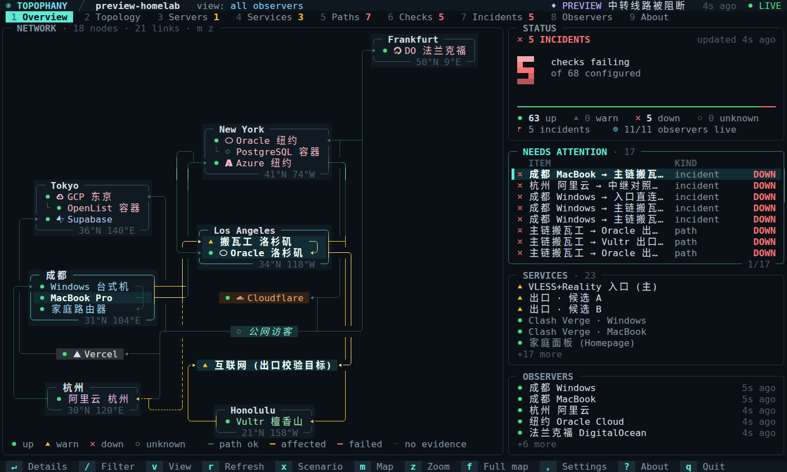

<h1 align="center">
  
</h1>

<p align="center"><b>从哪里出发，经由哪条路径，抵达了什么——依据又是什么。</b></p>

<p align="center">
  <a href="https://topophany.com/zh/"><b>topophany.com</b></a> ·
  <a href="https://github.com/WhitenWhiten/topophany/releases">下载</a> ·
  <a href="docs/GUIDE.md">用户指南（英文）</a>
</p>

<p align="center"><sub><a href="README.md">English</a> · <a href="README.ja.md">日本語</a> · <b>简体中文</b></sub></p>

<p align="center">
  <a href="https://github.com/WhitenWhiten/topophany/actions/workflows/ci.yml"></a>
  <a href="https://pkg.go.dev/github.com/WhitenWhiten/topophany"></a>
  <a href="LICENSE"></a>
</p>

**Topophany** 是一个自托管的监控工具，用来监控你的网络和其上的服务，并在终端界面中查看。它只有一个 Go 二进制文件 `topo`，以三种角色运行：**worker** 在所处的位置测量，**采集器**保存证据，**TUI** 告诉你哪里出了什么问题。

<p align="center">
  
  <br><sub>模拟故障时的 Overview，来自 <code>topo preview --lang zh --scenario 1</code>。</sub>
</p>

## 为什么选择 Topophany

- **证据，而非颜色。** 健康状态、证据来源和新鲜度是彼此独立的字段。没有通过的检查就不会变绿，没人监控的服务保持 `unknown`，缓存的视图会明确标出。
- **观测点是明确的。** 每个观测点都从它实际所在的位置测量。从家里看到的失败会被报告为那条路径的失败，而不是服务器宕机。
- **一眼就能读懂。** Overview 用一个结论、一张涵盖所有地点和路径的地图，以及需要关注的简短清单，回答*有没有出问题？在哪里？*
- **一个二进制，没有依赖。** 不需要 CGO、数据库守护进程或 Node.js，外部 Go 模块为零。

## 一分钟上手

从[发布页面](https://github.com/WhitenWhiten/topophany/releases)（Linux、macOS、Windows · amd64、arm64）安装，或者使用 Go 1.26.9 及以上版本：

```sh
go install github.com/WhitenWhiten/topophany/cmd/topo@latest
```

无需任何配置，就能用合成证据看到完整的界面。按 `x` 切换故障场景。内置拓扑和场景有英文、日文和中文版本，默认跟随系统区域设置，也可以用 `--lang ja` 指定：

```sh
topo preview
```

用演示拓扑和新生成的凭据，在本机运行一个真实的采集器：

```sh
topo init --dir ./demo
topo serve --config ./demo/topology.json --auth ./demo/auth.json \
  --data ./demo/collector-data --observer demo

# in another terminal
topo --credentials ./demo/credentials.json
```

## 工作原理

```text
  WORKERS                          COLLECTORS                  CLIENTS
  measure from where they are      keep the evidence           read it

  topo worker   (home laptop)  ─┬─▶  topo serve  (A)  ─┬─▶  topo          the TUI
  topo worker   (Tokyo server) ─┴─▶  topo serve  (B)  ─┴─▶  topo status   for scripts and agents
```

- **worker** 执行经过审阅的本地拓扑文件中的检查，把观测结果投递给一个或两个采集器；网络中断时在磁盘上缓冲。
- **采集器**维护只追加的日志（先 fsync 再确认），并推导出健康状态、事件和新鲜度。它会记住每个事件从发生到关闭的全过程，以及每项检查几个月来的可用性，可以把事件推送到 Webhook（ntfy、Slack、Discord 或 JSON），也可以自己执行检查。
- **客户端**是只读的。关闭 TUI 不会停止监控，Topophany 也从不修改路由、代理或服务。

| 命令 | 作用 |
|---|---|
| `topo` | 使用已保存的凭据，打开远程采集器的 TUI |
| `topo status` / `topo show TAB [ID]` | 以文本或 `--json` 输出 TUI 所显示的内容；`status` 还会通过退出码给出答案 |
| `topo login` | 保存并验证到采集器的连接 |
| `topo serve` | 运行采集器，也可以执行它自己的检查 |
| `topo worker` | 在本机执行检查并上报 |
| `topo edit` / `topo validate` | 在 TUI 中编辑拓扑文件 / 检查它并输出版本和契约 |
| `topo preview` | 用合成证据打开 TUI |
| `topo init` | 用新生成的凭据创建本地演示 |

运行 `topo help` 查看完整列表。

## 监控你自己的网络

1. **描述它。** 用 JSON 写一份拓扑：节点、链路、端点、服务、路径、观测点和检查。从 [`examples/homelab.json`](examples/homelab.json) 开始，用 `topo edit --config topology.json` 编辑，用 `topo validate` 检查。
2. **运行采集器**，放在你的设备都能访问到的地方，并启用 TLS：`topo serve --config topology.json --auth auth.json --data collector-data --listen 0.0.0.0:7447 --tls-cert server.pem --tls-key server-key.pem`
3. **运行 worker**，在每台你想作为测量起点的机器上：`topo worker --config topology.json --observer <id> --credentials worker-credentials.json --data worker-data`
4. **随处查看：** `topo login --server https://your-collector:7447 --project <name>`，之后只需 `topo`。

[运维指南](docs/OPERATIONS.md)（英文）介绍双采集器、systemd 单元和各项上限，[安全模型](docs/SECURITY.md)（英文）介绍令牌与传输。

## 它能检查什么

- **原生探针：** HTTP（状态码、正文、头部、出口 IP）、TCP、带证书校验的 TLS、SSH banner、DNS A/AAAA、UDP echo、ICMP（IPv4）。
- **代理链：** HTTP CONNECT、HTTPS CONNECT、SOCKS5 和 OpenSSH `-W`，可多跳串联。
- **只读适配器：** Mihomo、Tailscale、WireGuard。
- **边缘与平台：** Cloudflare（包括 Workers 和 Pages）、Vercel、Supabase。边缘的应答只证明边缘本身，而不是它背后的源站。

## 终端界面

九个标签页：**Overview**、**Topology**（虚拟地图、地理和网络三种地图）、**Servers**、**Services**、**Paths**、**Checks**、**Incidents**、**Observers** 和 **About**。

| 按键 | |
|---|---|
| `1`–`9`、`Tab` | 切换标签页 |
| `j` / `k`、方向键 | 在列表中移动 |
| `Enter` | 显示所选行的证据 |
| `/` | 筛选 |
| `v` | 切换查看的观测点 |
| `m` / `z` / `f` | 切换地图 / 缩放 / 只显示地图 |
| `q` | 退出 |

也可以用鼠标操作。颜色会适配 truecolor、256 色和 `NO_COLOR` 终端。[用户指南](docs/GUIDE.md)（英文）介绍了每个标签页和地图，以及如何用 `topo status`、`topo show` 和 `topo history` 让脚本和智能体读取全部内容。

## 文档

文档为英文。

| | |
|---|---|
| [用户指南](docs/GUIDE.md) | TUI、编辑、预览模式、语义、探针、多地部署 |
| [配置与 API 参考](docs/REFERENCE.md) | 每种实体、探针参数和 API 端点 |
| [运维](docs/OPERATIONS.md) | 双采集器、存储、恢复和资源上限 |
| [安全模型](docs/SECURITY.md) | 凭据、传输和权限边界（[审查](docs/SECURITY-REVIEW-2026-10-14.md)） |
| [场景](docs/SCENARIOS.md) · [验收](docs/ACCEPTANCE.md) | 测试证明了什么，以及哪些需要在真实硬件上检查 |
| [更新日志](CHANGELOG.md) | 发布历史 |

## 仓库结构

```text
cmd/topo        the single binary
internal/       model, config, probes, scheduler, journal, engine, API, client, outbox, view, TUI, preview
examples/       sample topologies and credential templates
deploy/         hardened systemd units for the collector and the worker
docs/           guides, reference and verification records
scripts/        acceptance and verification suites
site/           the topophany.com homepage (a separate module, not part of go install)
```

## 开发

```sh
go test ./...                # unit and integration tests
go test -race ./...
python3 scripts/verify.py    # the full acceptance suite (Linux, Go, Python 3)
make site                    # re-record the homepage's TUI replays and rewrite its pages
```

构建时不需要下载任何模块。提交修改前请阅读 [CONTRIBUTING.md](CONTRIBUTING.md) 和[行为准则](CODE_OF_CONDUCT.md)，并按照 [SECURITY.md](SECURITY.md) 中的说明私下报告漏洞。

## 许可证

[MIT](LICENSE)
