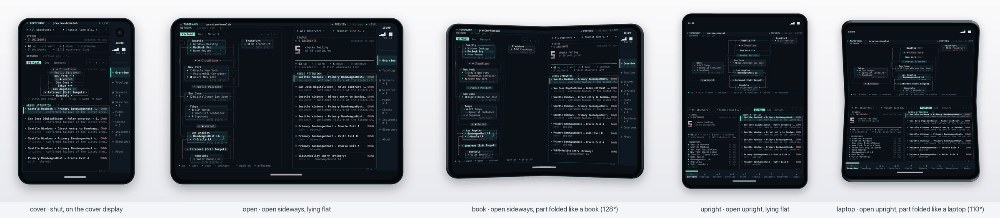

# Device layouts

`--device` lays the TUI out for the screen of an iPhone, an iPhone Duo or an iPad, and simulates that screen in the terminal. The terminal's look carries over whole, the same cells in the same palette; what changes is how each screen is laid out and how a finger works it. `scripts/device_shots.py` pictures each screen in its device's frame.

## The cell

On a device a cell is 7 points wide and 14 tall: a monospaced font at about 11.7 pt, at the homepage's 2:1 shape, so braille dots stay square. A device's window and what its system reserves in it (the safe-area insets, the Dynamic Island, iPhone Duo's clock column and its crease) are given in points and become whole cells: the page inside the insets rounded in, whatever the system covers rounded out. The iPhone Duo figures are those [measured on iPhone Duo](https://foldhunt.com/guides/everything-your-agent-needs-for-iphone-duo/).

| Device | Pose | Window (pt) | Cells | Page (cells) | Reserved | Layout |
|---|---|---|---|---|---|---|
| iPhone 6.5″ | portrait | 420×912 | 60×65 | 60×57 from row 5 | Dynamic Island | compact |
| iPhone 6.5″ | landscape | 912×420 | 130×30 | 112×28 from column 9 | Dynamic Island, left | wide |
| iPhone Duo | cover (shut) | 466×678 | 66×48 | 54×46 | clock column 12×13 with the camera | compact |
| iPhone Duo | open (sideways, flat) | 951×669 | 135×47 | 123×45 | clock column 12×9; crease at columns 65–70, resting | spread |
| iPhone Duo | book (128°) | 951×669 | 135×47 | 123×45 | the same; the crease active | spread |
| iPhone Duo | upright (flat) | 669×951 | 95×67 | 95×59 from row 6 | status cluster; crease at rows 32–35, resting | stacked |
| iPhone Duo | laptop (110°) | 669×951 | 95×67 | 95×59 from row 6 | the same; the crease active | stacked |
| iPad Pro 13″ | landscape | 1376×1032 | 196×73 | 196×70 | status bar | regular |
| iPad Pro 13″ | portrait | 1032×1376 | 147×98 | 147×94 | status bar | regular |

The crease (455.5 to 495.5 pt) falls on six whole columns sideways, 455 to 497 pt, and four rows upright, 448 to 504 pt. Laid out from the geometry, never from the pose's name, a pose that has the same geometry gets the same layout. The 6.5-inch iPhone's insets (62 pt above, 34 below) are those of the current Dynamic Island iPhones; the 6.3- and 6.9-inch ones are 57 and 62 columns wide and lay out the same way.

## Look and touch

Each tab has something to look at (the map, the evidence for the selection, a server's open card) and something to touch (what needs attention, the rows, the controls). Every layout but the tablet's decides where each goes:

- **compact**: a phone's page, one column. The tabs go in a sidebar rail, a glyph and its count a finger tall each, with `≡` over them for a drawer that names them; on iPhone Duo's cover they go in the system's column under its clock, named. The Overview stacks the status card, the map and what needs attention, a finger tall each; a tap opens a row as a page of its own, with a way back, the map above the evidence where the row has a place on it.
- **wide**: a phone on its side. The rail, then the map beside the status and what needs attention.
- **spread**: iPhone Duo open sideways. A leaf each side of the crease, the crease the gutter. What is looked at goes on the left leaf, the map or the evidence. What is touched goes on the right, beside the tabs in the column: the controls, the status card and the list.
- **stacked**: iPhone Duo open upright. The map above the hinge, the events and every control below it, the tabs along the foot. Part folded like a laptop, the raised half is the screen and the flat half the surface.
- **regular**: a tablet. The terminal's own layouts, unchanged, with chrome for fingers: tabs three rows tall and a toolbar of the footer's actions, each naming its key for a keyboard.

## By touch

A target is three rows tall, 42 pt, wherever it can be, and the tests hold every control to it. A tap acts when the finger lifts, where it went down.

| Gesture | What it does |
|---|---|
| Tap | selects a row; again, opens its evidence (on a phone the first tap opens it) |
| Swipe across | the next or the previous tab, on a phone's page |
| Swipe from the left edge | the drawer; from the left on a page opened from a list, back |
| Pull down at the top of a list | refresh |
| Pinch the map | magnify it 1×, 1.5×, 2× or 3×: the map is drawn larger, its cards and places saying more, and the screen shows a window of it, following the selection until a drag moves it |
| Drag the magnified map | look around it |

The controls are the terminal's own shapes: chips in rounded frames, segmented controls lit like the active tab, a filter field. `⋯` offers every action the footer would, built from the same list, so no screen and no pose loses one. Only quitting, which a phone's system does itself, the debug overlay and the editor's hints are left out, as a device views and never edits.

## iPhone Duo through its poses



- **Bending reflows nothing.** Lying flat, the layout already keeps the gutter where the crease will run, so open and book, and upright and laptop, draw the same cells; a test holds them to it.
- **Opening and turning keep the place.** Shut to open, the phone's column becomes the spread; sideways to upright, left and right become above and below. The tab, the selection, the evidence open and the map's magnification carry over.
- **The column.** Where the system draws its vertical bar (shut, and open sideways) the tabs go in its column, under the clock and the camera. Upright there is no column, and the tabs go along the foot of the lower half.
- **Clear of the system.** No control stands on the crease, under the Dynamic Island, the clock or the status cluster, or outside the safe area. The tests check every tab on every device.

## Fitted to the page

The website's viewers, [`/demo/`](https://topophany.com/demo/) and [`/app/`](https://topophany.com/app/), take the phone layout on a phone. A page no wider than 600 px is its own screen at its own size, with no simulator around it and nothing of the system's drawn in it (the browser keeps the status bar outside the page), in cells 7 px wide and 14 tall. A 390 px phone gets 52 columns, and the layout comes from the page's shape as on any device: compact upright, wide on its side, regular from 80 columns and 36 rows. The page sends the TUI a finger's presses and lifts, so a tap, a swipe, a pull and the drawer from the edge work as above, two fingers pinch the map a step for each quarter they spread, and a wheel over the page pinches or scrolls. Wider than a phone, the page goes back to the terminal's own layouts, 80 columns or more, in the terminal's cells.

`--device fit` does the same in a terminal: the terminal itself, at its size, laid out for touch, as a terminal app on a phone wants. A page shorter than the rail's tabs keeps the tab on show in its rail, under `≡`, and the drawer lists the tabs in two columns where one would not fit.

## Simulating it in a terminal

```sh
topo preview --device duo-upright      # or iphone, iphone-landscape, duo-cover, duo-open, duo-book, duo-laptop, ipad, ipad-portrait
topo --device iphone                   # the same against a real collector
topo --device fit                      # the terminal itself, laid out for touch
```

The simulator draws the device's screen at its size in cells, in its bezel, in the middle of the terminal; the terminal needs a few cells more than the device has (99×70 for iPhone Duo upright). `[` and `]` fold and unfold through the device's poses and `\` picks the next device; the bar under the screen does the same with a click. The mouse stands in for a finger: a click is a tap, a drag a swipe, the wheel over the map a pinch. The keyboard works as it does in the terminal, as a tablet's keyboard would.

### Leaving it out of a build

```sh
go build -tags nodevice ./cmd/topo     # or: make build TAGS=nodevice
```

A build with the `nodevice` tag leaves out the devices, their layouts, the touch controls, the zoomable map and the simulator, and `topo` and `topo preview` have no `--device`. The binary comes out about 155 KB smaller, within 20 KB of what it was before devices were added. The terminal draws the same cells either way: the header, the tabs, the status line and the key bar draw into the span a layout gives them in both builds, and only the device files carry the tag (`device_off.go` stands in for them). CI vets the build without them.

## Pictures of each screen

```sh
git clone --depth 1 https://github.com/WhitenWhiten/iphone-duo-simulator-skill /tmp/duo-kit
python3 scripts/device_shots.py --duo-kit /tmp/duo-kit          # writes .device-shots/, with an index.html
```

`TestDeviceShots` records each screen as the TUI draws it, and the homepage's terminal renderer paints it in a headless Chromium (Playwright's headless shell will do) at the device's own pixels, so the crease and the Dynamic Island land where the device has them. Each screen is then set in a frame the script draws. The book and laptop poses are folded in 3D by `duo3d.py` from the [iPhone Duo simulator kit](https://github.com/WhitenWhiten/iphone-duo-simulator-skill). The frames are not Apple's art. The script needs Pillow and numpy.

## Limits

- The cell is one size on every device.
- The hinge's angle plays no part beyond where the crease is and whether it is active.
