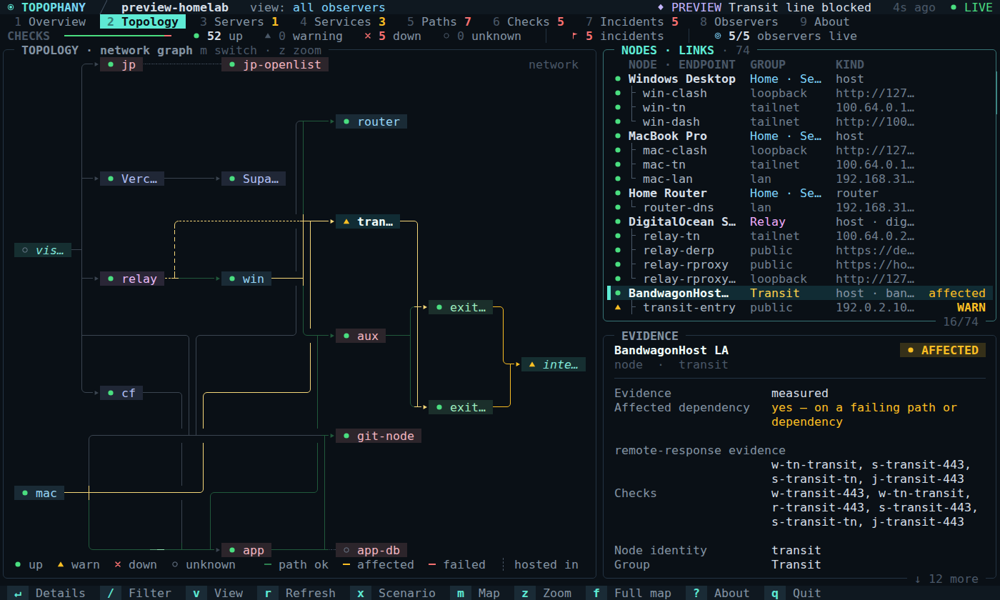
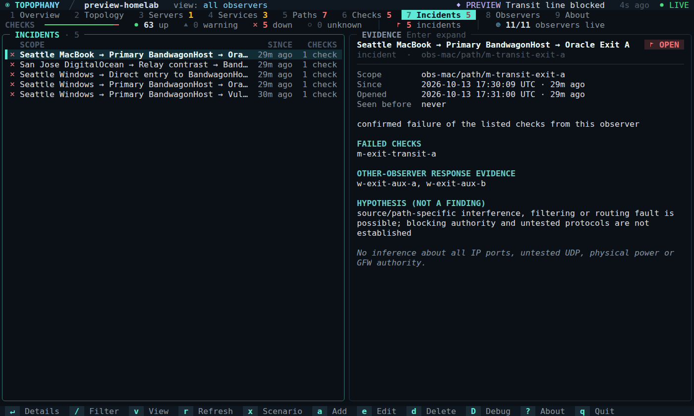
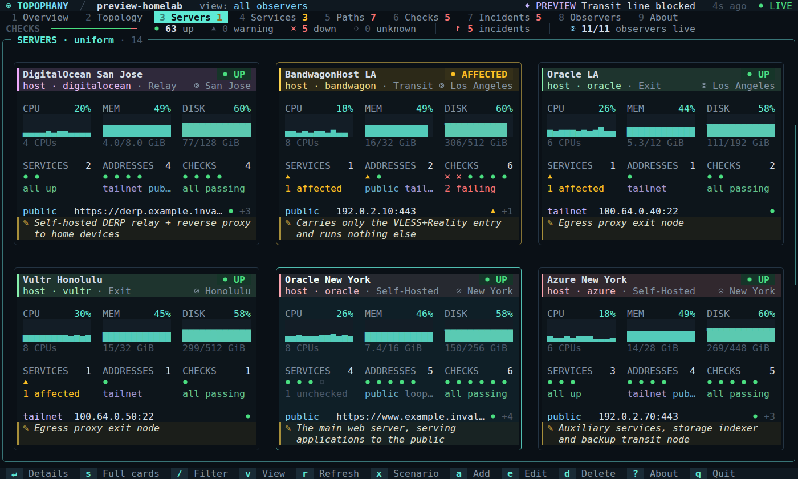
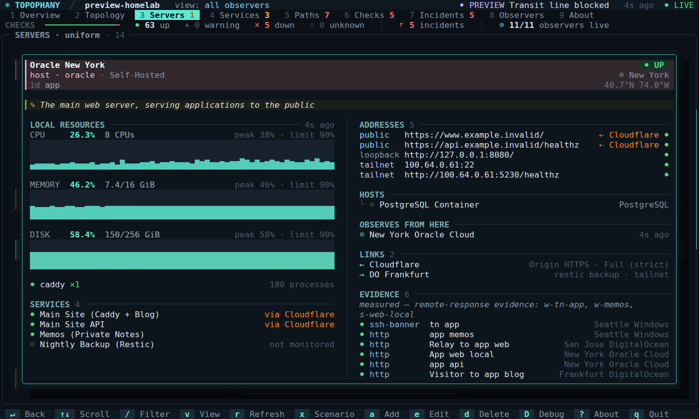
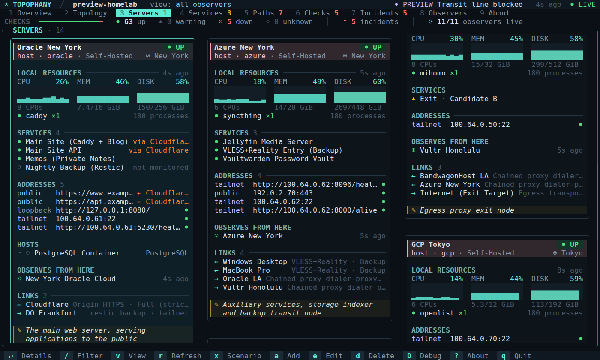

# User Guide

How to run Topophany day to day: the terminal UI, editing a topology, preview
mode, what the dashboard will and will not conclude, probes, deployment across
several locations, and how the code is laid out and verified. Start with the
[README](../README.md) for an overview; field-level detail is in the
[Configuration and API Reference](REFERENCE.md).

## The Local Demo

`topo init --dir ./demo` writes a demo topology, collector auth and client credentials; `topo serve` then listens on `127.0.0.1:7447` (the default listener). The demo configuration probes only this loopback API without reaching external targets; the registered workstation and notes-only service deliberately remain unmonitored (`unknown`), never feigning completion. The `init` command generates high-entropy random credentials on each invocation and refuses to overwrite existing directories.

On Linux and macOS, add the compiled `topo` binary to your `PATH`. On Windows, build as `topo.exe`. For detailed options, run `topo help`, `topo serve --help`, etc.

This codebase is a clean-room, verified release. It contains no production addresses, external network memos, or live credentials.

## Day-to-Day Use: Just Run `topo`

Deploy the collector server remotely and obtain a **viewer** token. Verify the expected project identity upon initial login:

```sh
topo login --server https://monitor.example.invalid:7447 --project homelab
```

Terminal token entry does not echo characters. For automated scripts, use `--token-stdin`; avoid persisting tokens in CLI arguments, screenshots, or shell history.

```sh
# token.txt must be a private file managed by the user; no default tokens exist.
topo login --server https://monitor.example.invalid:7447 \
  --project homelab --token-stdin < token.txt

topo                            # Connects to remote collector using saved credentials and opens TUI
topo --observer observer-local  # Explicitly select observation vantage point
topo --json                     # Emits a structured snapshot from the API without opening the terminal UI
topo status                     # The Overview as text: verdict, counts, what needs attention; the exit status says it too
topo show checks                # Any tab as a table; topo show checks ID gives the evidence behind one entry
topo history home-http          # A check's recent samples, newest first
topo --json --token-stdin < token.txt # Temporary override; token.txt must be private
topo --credential-file token.txt # Same override from a private file
```

Temporary overrides require `--server` for a multi-server profile and never
forward the override to an implicit failover destination. `--token-stdin` and
`--credential-file` are mutually exclusive; the former `--credential TOKEN`
option is no longer accepted, to keep tokens out of process arguments.

Credentials are saved by default to the operating system user configuration path under `topophany/credentials.json` (`$XDG_CONFIG_HOME` or `~/.config` on Linux; `~/Library/Application Support` on macOS; `%APPDATA%` on Windows). The `--credentials` flag overrides the file path, and `--profile` switches between saved project profiles. On Windows, files inherit ACLs from the user profile directory; **the application does not treat POSIX 0600 as a substitute for Windows ACLs** (verify per [SECURITY.md](SECURITY.md)).

Until the first snapshot arrives, the TUI shows the globe turning beside the wordmark and names the collector it is asking. Should none answer, the scene goes still and says which collector did not answer and why (connection refused, timed out, a host name not found, a TLS certificate from an authority not trusted here or for another name), tries again every 3 seconds (`r` tries at once) and says what to check. `topo status` and the other read commands give the same reasons in their error. Run without saved credentials, `topo` points to `topo preview`, `topo init` and `topo login`.

Custom or self-signed certificates require `--ca-file /path/to/ca.pem` rather than disabling certificate verification. Except for literal loopback addresses, plaintext HTTP connections are rejected by default. Use `--allow-insecure` only when plaintext transport across a secure private tunnel is explicitly intended.

## Browser Client

Open [topophany.com/app/](https://topophany.com/app/) (also `/zh/app/` and
`/ja/app/`) to connect the browser TUI to your own collector. Enter its URL,
the `project` from your topology, and a viewer token. The connection form is
inside the terminal frame and disappears once the viewer starts. `q` closes
the connection and returns to that form.

With the current collector binary, add `--web-origin https://topophany.com`
to your existing `topo serve` command. This permits that exact origin to read
the viewer APIs; authentication remains mandatory. Origins have no trailing
slash or path. To test the static site locally on port 8000, use
`--web-origin http://127.0.0.1:8000` and open
`http://127.0.0.1:8000/app/`. The collector's HTTP loopback URL may be
`http://127.0.0.1:7447`; other connections require HTTPS trusted by the browser.

The browser uses the same project, snapshot and history validation as the
native viewer. Failed reads retain existing evidence as cached; they never
substitute preview data. Credentials stay in the current tab/worker session,
are cleared from the form on submission, and are not put in URLs, cookies or
browser storage. Closing the session or leaving the page discards its worker.
Custom CA files, environment-variable tokens and insecure non-loopback HTTP
are native-client features; the browser uses its own TLS trust and an explicit
viewer token. Fetch redirects are refused before forwarding credentials.

`/demo/` remains a synthetic preview and uses a separate WASM build. The
browser client reads the collector's evidence; monitoring continues in the
collector and workers when the page is closed.

On a phone, both pages lay the TUI out for the page itself rather than
scrolling an 80-column terminal sideways: the phone layout of
[Device layouts](DEVICES.md#fitted-to-the-page), at the page's own width, with
the tabs in a sidebar rail and controls a finger tall. A tap selects or opens,
a swipe across turns the tab, two fingers pinch the map. Wider than a phone,
the page is the terminal again.

## Terminal Interface

The TUI is built to answer one question before anything is read: *is anything wrong, and where?*

- **Overview** — a verdict headline with a big failure count, a map of every node and link, the list of what needs attention (incidents, failing paths and services, silent observers), the services, and how fresh each observer is. Where the topology declares applications, the services card gives each application a line, with a mark for each of its services and how many need attention, and lists the services by name under their application where it has room, those needing attention first; otherwise it is a matrix of service names. Selecting an item lights its whole route on the map. On wide terminals the map sits beside the cards; smaller terminals stack them.
- **Topology** — the node → endpoint → link hierarchy beside the map, with the evidence for the selected entity underneath.
- **Servers** — a wall of cards, one per server: its state, kind, provider and place; the services it runs (and the edge in front of each); its addresses by network; the containers and VMs it hosts; the observers on it and its links; and your notes as a memo at the foot. Edges and platforms get cards too, listing what runs there, what they stand in front of, and the points of presence they answered from. `/` searches the memos as well; clicking a service, address or link opens it. Press `s` and the cards line up in a grid at one size, each saying the same things in the same places: the header, a panel each for CPU, memory and disk, how many services run there, how many addresses reach it and how many checks measure it, with a mark for each in its state and what needs a look in words, the address it is known by (its first public one) and the first two lines of its memo. In the resources' place, an edge or a platform, which has no machine of yours to read, says what it stands in front of and where it answered from; a host nothing reads says why (no worker runs there, or its worker runs no host check), and one whose reading has gone silent says when it was last read. Anything else a server lacks keeps its place empty, so the cards still read across; `s` brings the wall back. In either layout, `Enter` or a second click lays the selected card open over the others, which step back behind it: your notes first, as what the server is for, then its resources charted over the samples kept with each one's peak and limit, everything that runs on it and reaches it with nothing cut short, and the checks its state rests on, each leading to its evidence, in two columns where the terminal is wide. `↑↓` scroll it; `Enter`, `Esc` or a click beside it closes it. A node's evidence as the other tabs show it is on the Topology tab.
- **Services, Paths, Checks, Incidents, Observers** — aligned tables beside the evidence for the selected row. The state column stays empty for healthy rows, so problems are the only lit words, and a column in which every row says the same word (every check `fresh`, every item an `incident`) is left out, its room going to the names; it comes back as soon as a row differs. `Enter` expands the evidence behind a row. A check's evidence opens with its recent samples, read from the collector's history as the check is selected: a strip with one slot per sample, oldest at the left, colored by outcome (`●` ok, `▲` policy, `✖` fail, `○` error or unknown), and a grey `·` for each interval in which no sample was taken, so a silent worker shows as a gap rather than as health. Under it, a bar for what each passing sample took, then their median and 95th-percentile times and, where the probe timed them, the median DNS, connect, TLS and first-byte times. The strip is read again when a newer sample arrives; a failed read keeps the samples already shown and says it was not refreshed. Below the check's state, **Availability** says how it fared over the last 24 hours, 7 days and 30 days, from the collector's long-term rollups: the share of the measured time it was up, over the share of the window that was measured, then how long it was down, degraded (a policy violated) or inconclusive (the monitor could not tell), such as `99.2% up over 96% measured · down 11m`. Each sample's outcome stands until the next sample or until it goes stale, so time without a current sample, as when a worker falls silent, is unmeasured rather than up; where the rollups begin inside a window, it says when they were first kept. The Checks tab shows the last day's share up as **UP 24H**, with how much of the day was measured when it was less than all of it (`98.9% · 3h`), and blank when nothing was measured.
- **About** — a lit globe: a shaded ocean, dotted land and a graticule that curves with the surface, on which the places you declared are the only lights. The mouse wheel spins it, and it stays round on terminals whose character cells are not twice as tall as they are wide. Beside it are what the name means, the version, links to [topophany.com](https://topophany.com) and the source on GitHub, and, where there is room, the keys of the mode you are in.

The **Incidents** tab lists the incidents open, then what the collector's ledger remembers: incidents recovering, whose failed checks pass again short of their recovery threshold (these still need attention), and those closed in the last day, each occurrence on its own row with an ID that counts it, such as `3f2a9c1b04de/home/path/direct#2`, and how it ended: recovered, unconfirmed (its evidence lapsed or no longer confirms the failure, so recovery is not established), paused, or changed (what its checks measure changed). An incident's evidence says when the collector opened it, how often it was seen before and, once closed, how long it lasted. A collector can also post incidents opening and closing, and observers falling silent, to webhooks such as ntfy, Slack or Discord; see [alerts](REFERENCE.md#alerts).

Tabs count what in them needs a look: servers, services and paths that are down, degraded or on a failing path, failing checks, open and recovering incidents, and observers that are not reporting or that report measuring an outdated topology (after a collector reload, until their worker reloads too). The count is red when anything is down and amber otherwise; when the tabs are short of room, the tab's number takes the color instead. A cached view counts nothing, because it knows nothing current.

<table>
  <tr>
    <td width="50%"></td>
    <td width="50%"></td>
  </tr>
  <tr>
    <td align="center"><sub>Topology as a network graph</sub></td>
    <td align="center"><sub>An incident and its evidence</sub></td>
  </tr>
  <tr>
    <td width="50%"></td>
    <td width="50%"></td>
  </tr>
  <tr>
    <td align="center"><sub>Servers as uniform cards (<code>s</code>)</sub></td>
    <td align="center"><sub>A server's card laid open (<code>Enter</code>)</sub></td>
  </tr>
</table>

Press `m` to cycle the map through three modes:

- **virtual geo** — the default when any node has a `location`: a schematic of the world that keeps its order but not its distances, so a crowded city gets as much room as a lone island. Each place is a card with its name on top and its coordinates along the foot. Cards stand in columns from west to east along the shorter way round, north above south, and neighbouring places share a column when the terminal is narrow; a card widens to show its names in full wherever the gaps can spare the room. Every node has a row of its own on its card, with containers and VMs indented under their hosts; links run as wires from row to row, arrowed where they arrive, and links between two nodes at one place are brackets inside the card. Wires that leave one node or reach one node share a trunk, and otherwise only cross at right angles, so a junction always belongs to a node. Nodes without a location, such as edges and the internet, float as pills beside what they connect to. Wires carry the same evidence colors as the other maps, with a glint running along those whose traffic gets through, and a card with a problem tints its frame. On a short map, cards fold their rows into "+2 more" and then into one-row chips; should a dense graph leave a link no room, the legend says how many links are not drawn.
- **geo** — a braille dot-matrix world map (2×4 dots per cell, Natural Earth 1:110m land) that places nodes by their declared `location`, never by IP address. Nodes at one place are clustered into a single site; each pair of sites gets one arc. A site is labelled by a plate: its place over a row for each node, set down where it covers the least land and the fewest arcs, beside its marker when there is room and joined to it by a thin leader when not, so a crowded region spreads its labels into the sea around it. On a short map a plate shows fewer rows and counts the rest, then folds to one line with a glyph per node. An arc is green when its link is measured up or a declared path over it succeeds, amber when it is degraded or on a failing path, red when it fails, and grey when nothing has measured it; healthy arcs stay faint so that problems stand out, and hops implied only by a declared path are dashed. Flow pulses run only along links with positive evidence, and sites with a problem ripple. Nodes without coordinates wait in a "no location" tray. The view crosses the antimeridian on the shorter side, and `z` cycles between fitting every site, focusing the selection, and the whole world. `p` hides the plates and draws every arc dashed, leaving the markers and the lines; `p` again brings the plates back, and does nothing on the other maps. Fitting every site, a stretch of longitude wider than 60° with no site in it, such as the Pacific between Shanghai and Los Angeles, folds to a narrow blank seam with a dotted line down it and, above, how many degrees it holds ("98° folded"), so the coasts on either side get the width; the focus and world views are never folded.
- **network** — a left-to-right layered graph drawn as a schematic: sources on the left, each link one column further, long links routed around the nodes in between. Nodes are chips colored by group, and a name its column cuts short runs on into free cells to its right; wires leave a chip to the right and turn once before the next column, wires from one source share a track, crossings are bridged, and "hosted in" relations are dotted. Selecting a path or incident highlights its hops.

Press `f` and the map has the screen to itself: the list and the evidence step aside, the selection still moves with the arrow keys and is named with its state along the map's foot, and `Enter` opens its evidence. With the room, labels say more. On the virtual geo each node is followed by what runs on it, on a line of its own when the cards have the height, services with a problem first and in their color, and cards may grow wider, sharing columns sooner since there is height to spare; a geo plate names a node's services after it.

| Keys | |
|---|---|
| `1`–`9`, `Tab` / `Shift-Tab`, `h` / `l` | switch tabs (`?` toggles About) |
| `j` / `k`, arrows, `PgUp` / `PgDn`, `g` / `G` | move through the list |
| `Enter` | expand evidence for the selected row; on Servers, lay its card open over the others |
| `/` | filter rows |
| `v` | cycle observer vantage points |
| `m` / `z` | cycle the map (virtual geo, geo, network) / zoom the geo map |
| `p` | on the geo map, hide the site plates and draw dashed arcs, leaving the markers; `p` brings the plates back |
| `s` | on Servers, line the cards up at one size, each saying the same things; `s` brings the wall back |
| `f` | show the map alone, on the Overview or Topology (from another tab, the Topology's); `f` or `Esc` brings the panels back |
| `r` | refresh now |
| `D` | debug overlay: frame time, bytes written, map geometry |
| `q` | quit |

Tabs, rows, footer buttons, map sites, menus and modal buttons all respond to the mouse, and the wheel scrolls lists.

The UI paints its own dark ink background, so contrast is the same on dark, light and tinted terminal themes; set `TOPO_BACKGROUND=terminal` to keep your terminal's background instead. Truecolor terminals get 24-bit color and others fall back to xterm-256; under `NO_COLOR` every escape for color is dropped and selection switches to plain glyphs such as `›` and `[a]`. Only the cells and colors that change are written to the terminal. Links are written as OSC 8 hyperlinks, which terminals that support them open on a click, usually with a modifier key held because the TUI uses the mouse; the Linux console and GNU screen get plain text, and `TOPO_HYPERLINKS=0` or `1` decides outright. The terminal window is named after the verdict, such as `✖ 2 incidents · homelab · Topophany`, so a tab bar or taskbar shows trouble while the TUI is out of sight; the window's own title is put back on exit. Wide characters and full UTF-8 are supported; the recommended geometry is at least 100×28 (minimum 30×10), and the layouts adapt to whatever space there is. Every setting read from the environment is listed in the [reference](REFERENCE.md#environment-variables).

**On Windows Terminal, set `TOPO_CELL_ASPECT`.** The About globe and the geographic map are drawn for the shape of a character cell: how many times taller than wide it is. Many terminals give it with their size or in answer to a query, but Windows Terminal answers with a fixed 10×20 cell whatever its font and line height, so where its cells are not 2:1 the globe comes out an upright oval and the continents too tall. Put the real shape in your shell profile, for example `export TOPO_CELL_ASPECT=2.6`. To find it, divide the distance from one line of text to the next by the width of a character, in pixels from a screenshot, or try values until the globe is round. The same applies to any terminal that reports no cell size; the default is `2`.

### Editing Topology

The remote TUI is read-only: the collector server **deliberately provides no remote configuration mutation API**. Pressing `a`, `e`, or `d` prompts the user to invoke the local editor. Topology edits operate on reviewed local files:

```sh
topo edit --config topology.json            # Creates file upon first save if absent
topo edit --config new.json --project lab   # Sets project ID for new configuration files
```

In the editor, `a` opens the Add menu (Nodes, Links, Endpoints, Services, Observers, Paths, Checks; defaults to the highlighted entity type), `e` edits the selected item, `d` deletes an item (refused with an explanatory error if still referenced), `u` undoes changes, `Ctrl-S` saves, and `q` prompts for confirmation if unsaved changes exist. Every edit triggers a complete `topo validate` pass; validation failures remain in the form with error details. In the Node form, entering recognized city names in the Place field autocompletes latitude and longitude coordinates. The Check form shows the options of the kind chosen (HTTP status and body for `http`, the name and record type for `dns`, thresholds and the process for `host`); what the others hold is kept. Saving is atomic, preserving file permissions (`0600` for new files) and updating the revision hash. Collectors and workers apply the saved file when reloaded (`SIGHUP`, or `systemctl reload` with the shipped units) or restarted. Unmodeled fields (such as proxy chains in paths) are preserved as-is.

### Preview Mode (Synthetic Evidence)

`topo preview` opens the TUI without connecting to a collector, driving layout and rendering with a rich built-in topology and synthetic observation history:

```sh
topo preview                         # Built-in topology: local site nodes, cloud relay, primary/backup transit gateways, dual egress nodes, application clusters, and regional edge nodes
topo preview --scenario 2            # Opens in the steady state of a specific scenario (index toggled by x in TUI)
topo preview --config topology.json  # Runs synthetic scenarios against your own topology file (non-matching scenarios hidden automatically)
topo preview --json                  # Emits a synthetic snapshot JSON without entering TUI
topo preview --print-topology        # Dumps the built-in topology JSON to stdout for customization via topo edit
topo preview --lang ja               # Writes the built-in topology and the scenarios in Japanese (en, ja, zh)
```

The built-in topology and the scenario names follow the locale: the first of `LC_ALL`, `LC_MESSAGES` and `LANG` that is set picks English, Japanese or Chinese, and any other locale gets English. Only the words change; the topology, the scenarios and the evidence are the same in every language, and `topo preview scenarios --json` names each scenario by an `id` that does not change with it.

In the built-in preview topology: local workstations connect across primary transit gateways to regional egress nodes for external verification; a backup transit gateway serves as failover; Tailscale connects nodes across locations; a central cloud relay provides DERP relaying and reverse proxying; and Cloudflare fronts the main site while running a Worker and a Pages site, beside a Vercel app that depends on Supabase. Press `x` to switch scenarios (transit filtering, host downtime, egress IP drift, local uplink failure, maintenance, clock skew, an origin down behind Cloudflare, the edge unreachable from the mainland, collector unreachable, etc.). CLI-specified scenarios initialize in an established state; switching scenarios inside the TUI begins at the current time, applying confirmation thresholds and expiration rules in real time. Evidence is derived from simulated observations through the state engine rather than hardcoded UI colors. Press `D` to toggle debug overlays (frame render duration, redraw bytes, map node count). The topology in preview mode is read-only.

The full `topo preview --lang zh` topology includes independent CPU, memory, disk and process counters for its ten hosts and router. Press `3` for the Servers cards, where a panel for each of CPU, memory and disk fills as far as it is used, its top tracing the last few minutes; `Enter` on a card lays it open with each charted over the samples kept, its peak and its limit, and `6` and `Enter` on its check charts each over the recent samples with its limit drawn across. Press `x` for CPU saturation on the application host, memory pressure on the relay, disk nearly full on exit A, and a missing process on the transit host. Resource values vary over simulated time and use the topology's real thresholds to produce policy incidents under the configured policy confirmation setting. Node downtime stops the corresponding worker samples; returning to normal restores them. All values are synthetic; preview reads no host resources. The smaller `--config examples/host-resources.json` remains available.



`--device` lays the TUI out for the screen of an iPhone, an iPhone Duo or an iPad, and simulates that screen in the middle of the terminal: `topo preview --device duo-upright` puts the map above iPhone Duo's hinge and the events below it. `[` and `]` fold and unfold through the device's poses and `\` picks the next device; a click is a tap, a drag a swipe and the wheel over the map a pinch. `--device fit` lays out the terminal itself for touch, at its own size, as a terminal app on a phone wants. [Device layouts](DEVICES.md) describes each device's layout and the touch design, and how `scripts/device_shots.py` pictures them.

When collectors are unreachable, cached data is retained but items transition to `unknown` and are marked CACHED; `topo status`, which keeps no cache, exits 4 instead. Switching to a backup collector never silently changes the observer vantage point. The TUI queries the HTTP API every 3 seconds (preview mode regenerates synthetic snapshots every second); SSE and browser-based frontends are not implemented.

## Reading from Scripts and Agents

Everything the TUI shows can be read from the command line, for a script, a cron job or an AI agent. The TUI and these commands draw on one derivation of the snapshot (`internal/view`), so they cannot disagree, and a test holds them to it across every preview scenario.

```sh
topo status                          # The Overview: verdict, check counts, tab counts, what needs attention, services, observers
topo show TAB                        # A tab as a table: overview, topology, servers, services, paths, checks, incidents, observers
topo show TAB ID                     # The evidence behind one entry, as the TUI's evidence panel has it; a server adds its card, a check its recent samples
topo show topology node:home         # IDs are unique within a kind; KIND:ID picks one where a tab mixes kinds
topo show map                        # The map's nodes and edges, with what each may claim (up, carried, affected, ...)
topo history CHECK --limit 50        # A check's raw samples under its current contract, newest first (1..500)
topo history CHECK --step 1h --span 7d   # How a check fared hour by hour from its rollups (steps 5m, 1h, 1d)
```

Each takes `--json` for the same view as data (rows keep their state, columns and every evidence line; servers carry their cards, and a check shown on its own its strip of recent samples as `samples`, slot by slot, with their latency), `--observer ID` for one vantage point, and the connection flags of `topo` itself (`--credentials`, `--profile`, `--server`, ...). Flags may come before or after the arguments. Text is plain: no color, one entry per line, with `Key: value` lines and aligned tables; control characters from the evidence are dropped.

`topo history --step` reads a check's rollups rather than its samples: one row per slot, oldest first, with the share of it up and measured, how long it was down, degraded or inconclusive, the samples taken and their median and 95th-percentile times, under a total for the whole span. `--span` sets how far back it reaches (by default a day of `5m`, a week of `1h`, 90 days of `1d`); slots older than the collector keeps that finely come as wide as it keeps them, and days begin at 00:00 UTC.

`topo status` answers in its exit status as well, so a script need not read the text:

| Exit | Meaning |
|---|---|
| 0 | All clear: every active check in the view passes and nothing needs attention (paused and maintenance checks are excluded) |
| 1 | The command failed (bad arguments, credentials, a collector's refusal) |
| 2 | Something needs attention: an incident, a failing or degraded check, a service on a failing path, a silent observer |
| 3 | Evidence is incomplete: no checks, no current evidence, an expired snapshot, or an active check with unknown/stale evidence even if other checks pass |
| 4 | No collector answered (also for `show` and `history`) |

The same commands read the preview's synthetic evidence, which makes a safe rehearsal for an agent: `topo preview scenarios` lists the scenarios, and `topo preview --scenario 10 status` (or `show`, `history`) reads one in its settled state without a collector.

## Core Semantics

| Observed Fact | Dashboard Behavior |
|---|---|
| Local connection to primary transit fails on probed port while cloud relay comparison succeeds | Local path marked abnormal; alternate vantage point retains success evidence; not counted as physical server downtime |
| TCP connection establishment (accept) succeeds | Confirms only connection establishment; insufficient to verify application protocol, proxy authentication, or full path health |
| Transport fallback succeeds while proxy authentication fails | Results reported separately; standard web fallback does not prove proxy tunnel availability |
| Controller reports routing group switched to backup path | Displays runtime routing choice; does not declare business restoration without end-to-end check |
| Request succeeds but egress IP violates policy | Reports `policy` outcome; reachability and egress policy constraints evaluated separately |
| Executor stops reporting | That observer perspective gradually transitions to stale / unknown; does not mark all remote assets down |
| Registered but unmonitored service | Marked "registered, not monitored"; does not default to green |
| Primary path fails while candidate path succeeds | Candidate reported available, redundancy degraded; does not automatically assert production traffic has switched |
| Request through Cloudflare gets HTTP 521 from the edge | The edge answered and stays up; the origin is not credited with the edge's answer; the incident places the fault behind the edge without establishing the origin's own state |

Health outcomes, evidence sources, and freshness are distinct fields. The Services tab displays configured access check results, not unmeasured process internals. Dependency propagation flags affected scope without fabricating downstream downtime evidence. Incident analysis does not make inferences about upstream middlebox enforcement, broad IP blocking, untested UDP ports, or physical server power status.

## Probes and Protocol Adapters

Native probes include HTTP assertions, TCP, TLS with certificate validation, SSH banner, DNS A/AAAA (UDP with truncated TCP fallback), UDP echo with random nonces, and IPv4 ICMP. HTTP probes support expected status codes, substring/regex body matching, response header assertions, and egress IP/CIDR constraints; they can pin dial IPs while preserving Host/SNI, or bind to local source IPs. Insufficient ICMP permissions are classified as monitor configuration errors rather than target outages.

Host resource checks (`kind: "host"`) collect CPU use, physical memory, filesystem capacity/inodes and process counts on Linux, macOS and Windows, including matching process count and RSS for an optional exact name. Start with [`examples/host-resources.json`](../examples/host-resources.json): `topo once --config examples/host-resources.json --observer local` prints one sample without a collector. To monitor continuously, add a host check to the topology used by both collector and worker, select the worker's observer, and reload both. Configure optional percentage and process-count assertions in the `host` object; failed assertions become policy incidents on the first current violation by default, or after `policy_threshold` consecutive violating samples when explicitly configured. `topo edit` exposes these fields; the Servers cards and Checks → Enter chart the metrics. See [Host Resources](REFERENCE.md#host-resources) for platform semantics and limits.

Explicit outbound proxy chains support multi-hop combinations of HTTP CONNECT, HTTPS CONNECT, SOCKS5, and strict OpenSSH `-W` stream forwarding as an initial hop. SOCKS5 passes domain names to the proxy for remote resolution, never falling back to direct connections on failure. OpenSSH adapters require an installed `ssh` binary, dedicated keys, and pre-verified `known_hosts`; they reject unverified host keys, interactive passwords, and arbitrary shell commands.

Layered proxy protocols (such as Reality, XHTTP, or VLESS) are hosted by external proxy engines (e.g. Mihomo). Configure dedicated loopback SOCKS/CONNECT listeners for candidates, then have Topophany verify end-to-end requests; the tool never mutates production routing groups, restarts proxy cores, or creates unmanaged production listeners. Production TUN interfaces, explicit production proxies, and isolated test cores must be registered under separate check scopes.

The Mihomo adapter reads only `/configs`, `/proxies`, and `/providers/proxies`, recursively expands `dialer-proxy` chains, and records mode, TUN status, selected nodes, provider names/order, and test URLs. It is forbidden from invoking latency measurement endpoints that could influence routing decisions, and never queries full client connection tables. Parameter consistency cannot be verified solely by node name, and sequential API reads do not form an atomic snapshot.

Tailscale status is queried via local `tailscale status --json`; WireGuard reads only the public `latest-handshakes`, `transfer`, and optional `allowed-ips` and `persistent-keepalive` fields with `wg show <interface> <field>`. It never requests `dump`, private keys or preshared keys. Both serve as auxiliary telemetry and do not substitute for end-to-end service checks; idle states or older handshakes do not immediately declare outages. Missing host executables report monitor-side errors.

## Edges and Platforms

Sites behind Cloudflare and apps on Cloudflare Workers or Pages, Vercel or Supabase are modeled directly. An edge network is a node of kind `edge` with a `provider`; a managed platform is a node of kind `platform` (which may carry its region as a location). A service deployed there names it as its node and says how it runs in `runtime`; an address served through an edge lists the edge in `via`:

```json
"nodes":     [{"id": "cf", "name": "Cloudflare", "kind": "edge", "provider": "cloudflare"},
              {"id": "db", "name": "Supabase", "kind": "platform", "provider": "supabase",
               "location": {"label": "Tokyo", "lat": 35.68, "lon": 139.77}}],
"endpoints": [{"id": "blog-web", "node": "origin", "address": "https://www.example.invalid/", "network": "public", "via": ["cf"]},
              {"id": "short", "node": "cf", "address": "https://go.example.invalid/healthz", "network": "public"}],
"services":  [{"id": "shortlinks", "name": "Short links", "node": "cf", "runtime": "workers", "endpoints": ["short"]}]
```

The edge answers first, and the evidence says so. Any answer from it, even an error page, proves the edge and nothing behind it. What an edge says of where its answer came from, a cache status such as `MISS` or `DYNAMIC` included, is the answer's own word, which the edge or the origin can send whatever happened, so it never proves the origin; an origin reached only through the edge reads unknown and says so. To know the origin's own state, give it a check that does not go through the edge. HTTP probes record which edge answered and from where (`CF-Ray`, `X-Vercel-Id`, `X-Amz-Cf-Pop`, `X-Served-By`) and whether its cache served the response, so a check's evidence reads, for example, *answered by Cloudflare NRT · cache DYNAMIC*. In the TUI, services list the way in (`Cloudflare ⇢ S1`) or where they run (`Cloudflare · workers`), and the maps draw an implied hop from an edge to the node behind it when no link declares one.

Ten providers are known by name: Cloudflare, Vercel, Supabase, GCP, Azure, AWS, Oracle, Deno Deploy, Linode and DigitalOcean (a `provider` may also say `google`, `microsoft`, `amazon`, `oci` or `do`), with Netlify, Fastly, CloudFront, Fly.io, Render and Railway named and colored too; any other provider is shown as written. Edges and platforms take their provider's brand color, while a machine you run keeps its group's. Where a card has no room for the edge a service or an address is reached through, the edge's mark stands in for its name (`CF`, `▲`, `SB`, `GCP`, `AZ`, `AWS`, `OCI`, `DN`, `LN`, `DO`).

With a [Nerd Font](https://www.nerdfonts.com) (v3.3 or later) in the terminal, `--nerd-font-icons` or **Nerd Font icons** in Settings has the nodes those ten run wear their provider's logo before their names: on their cards, on the maps and in the Services tab's HOST column, and an edge wherever it is named in front of something, its logo standing in for its name where that has no room. A terminal cannot tell which font it draws with, so the option is off by default; without such a font the logos show as boxes. A `Nerd Font` (rather than `Nerd Font Mono`) draws them about a letter and a half wide, into the space after each. Oracle's is an oval ring after its mark, since the fonts' Oracle logo is its wordmark, a line at the size of a letter. The logos are their owners' trademarks, shown to say who runs what.

## Multi-Location and Dual Collector Deployment

The central server can execute its own baseline checks: `serve --observer observer-cloud-relay`. To measure local residential paths toward remote targets, run a worker on the local node: `worker --observer observer-local-workstation`; remote servers cannot substitute for local observation. Workers execute only locally reviewed configurations; collectors cannot dispatch arbitrary probe targets or commands to workers.

```sh
# Deploy identical reviewed topology.json configurations to respective machines.
topo serve --config topology.json --auth auth.json --data collector-a \
  --listen 0.0.0.0:7447 --tls-cert server.pem --tls-key server-key.pem

topo worker --config topology.json --observer observer-local-workstation \
  --credentials worker-credentials.json --data worker-local
```

Configure two collector endpoints in the worker's credential profile under `servers`. The worker dispatches to both independently, buffering in a local bounded outbox during network partitions. Each collector maintains independent storage; never share database or journal directories across NFS/SMB mounts. Client credentials can also configure multiple endpoints for read-only failover. **Viewer and worker roles must use distinct tokens.**

Collectors must share matching project identities and the same reviewed topology. An observation whose check measures something else on a collector than it did on the worker (a different measurement contract) is rejected and quarantined, preventing stale measurement definitions from corrupting active metrics; edits that change nothing a check measures do not disturb it. Data is fsynced prior to returning delivery ACKs; retransmitted records retain original sample timestamps; duplicate deliveries are deduplicated by observation ID. Permanently rejected records are retained for administrative review under hard storage quotas; when quotas are reached, probing stops with an error rather than silently discarding evidence.

This architecture provides multi-replica availability for observations and dashboards, not a distributed consensus cluster for administrative mutations. There is no automated leader election and no remote management takeover. Shared upstream networks, common egress gateways, and local worker host failures remain common points of failure. For details, see [Deployment and Operations](OPERATIONS.md).

## Configuration, Resources, and Architecture

Configurations use strict JSON rather than maintaining parallel YAML and database copies. Running `topo validate --config topology.json` validates references, dependency loops, execution scopes, timing budgets, and probe compatibility, emitting a normalized summary with the topology's revision and every check's measurement contract.

Each check's samples count only under its **measurement contract**, a digest of what it measures: its kind, observer, target, timeout, bind and resolve settings, assertions, adapter options and the proxies of its path. Editing anything else, such as a note, a name, a place, a threshold, an interval or another check, leaves a check's contract, its samples, its history and the ID of its incident as they were, so an operator can annotate the topology freely; changing what a check measures starts it afresh. Field-level detail is in the [reference](REFERENCE.md). Configuration updates apply on `SIGHUP` (`systemctl reload`; on Windows, restart): a collector reads its topology and `auth.json` again and a worker its topology, both on the file they were started with. A file that fails validation, names another project or drops the process's own observer is refused, logged, and the running topology kept; a successful reload logs which checks measure something new and so start afresh. Nothing reloads by itself, and there is no remote mutation API.

`examples/homelab.json` provides an anonymized modeling template with **all checks paused by default**, using documentation IP ranges and `.invalid` domain names. Populate actual endpoints, dedicated listeners, credential environment variables, and observer definitions before enabling checks individually. `examples/minimal.json` provides a loopback demonstration topology matching `init` output without tokens.

This version uses standard library ANSI escape sequences for the TUI and a local append-only log with checkpoints, **without Bubble Tea or SQLite**. This deliberate architectural decision ensures the entire codebase builds without external dependencies. Resource usage is strictly bounded: default raw history retains up to 20,000 records or 24 hours, storing 40 trailing state samples per check with deduplication receipts kept for the ingestion window and an hour; long-term rollups are capped at 32 MiB (`--rollup-bytes`), and the worker outbox defaults to 32 MiB. Operators requiring larger scale should evaluate retention and snapshot strategies rather than continuously increasing memory ceilings.

```text
cmd/topo           Single binary entrypoint
internal/model     Shared data models and API contracts
internal/config    Strict configuration, validation, revision hashing, and redaction
internal/probe     Native protocols, proxy dialing, and local tool adapters
internal/runner    Bounded, staggered, target-exclusive probe scheduler
internal/store     Single-writer append log, checkpoints, recovery, and deduplication
internal/engine    Freshness tracking, evidence aggregation, and dependency state derivation
internal/ledger    A collector's record of incidents opening, recovering and closing
internal/alert     Webhook alerts for what a collector concludes
internal/api       Collector HTTP API and scoped token authorization
internal/client    Credentials, project identity validation, and read-only failover
internal/outbox    Durable dual-dispatch queue, backoff retries, and quarantine handling
internal/view      What a reader is shown, derived once for the TUI and the CLI: verdict,
                   counts, each tab's rows and evidence, server cards, map edges
internal/tui       Native terminal handling, keyboard/mouse input, 9 tabs, dot-matrix canvas,
                   geo/network topology maps, About globe animation, and local editor
internal/preview    Built-in rich topology and synthetic scenarios for offline TUI preview
internal/app        CLI subcommand dispatch and wiring
scripts            Automated acceptance, verification, and process/PTY integration tests
deploy             Hardened systemd unit templates for collector and worker
examples           Sample topologies and credential file templates
docs               Reference, operations, security model, scenarios, and verification records
```

Service management boundaries display deployment nodes, ingress endpoints, notes, and runbooks. Remediation actions are left to authorized external operations tooling. **This release contains no remote shell, arbitrary script execution, or automated remediation APIs**; it is not a privileged backdoor disguised as an agent.

## Testing and Verification

```sh
go vet ./...
go test -count=1 ./...
go test -race -count=1 ./...
go test -count=3 ./...
python3 scripts/verify.py             # Complete acceptance suite (Linux + Go + Python 3)
```

Test suites cover real local HTTP/TLS servers, DNS UDP/TCP resolution, UDP nonce reflection, ICMP packet encoding/decoding and permissions (raw socket tests run only when privileges are available), CONNECT->SOCKS5->CONNECT 3-hop proxies, configuration/credential boundaries, journal and outbox crash recovery/deduplication, structured fixtures for external adapters, Linux PTY and independent collector/worker/TUI processes, and time-bounded fuzzing.

[SCENARIOS.md](SCENARIOS.md) maps design scenarios to automated test cases without fabricating observations for unmonitored infrastructure. `scripts/verify.py` writes command logs, exit codes, test events, code coverage, fuzz results, cross-compilation builds, and live process acceptance logs to `.verify-build/verification/` (CI publishes them as the `verification` workflow artifact). When reviewing results, distinguish between top-level test functions, subtest events, and fuzz seeds; these are not conflated into independent feature scenarios.

Targeted [Mihomo v1.19.32 real-core acceptance](acceptance/MIHOMO_2026-10-17.md) records macOS ARM64 and Linux AMD64 inventory capacity runs separately from synthetic fixtures. It does not establish physical Windows TUN capture, other core versions or proxy protocols, live Tailscale/WireGuard tunnel failure behavior, Topophany SSH-jump cryptography, or intermittent transit fault acceptance. Cross-compilation passes do not substitute for native runtime execution. Complete the relevant remaining [Hardware Acceptance Checklist](ACCEPTANCE.md) items for each deployment.

## Applications and environments

Declare optional `applications` in the topology and assign each service an
`application` ID and an `environment` such as `production` or `staging`:

```json
"applications": [{"id": "shop", "name": "Shop"}],
"services": [{"id": "api", "name": "API", "node": "app",
              "application": "shop", "environment": "production"}]
```

See [`examples/applications.json`](../examples/applications.json) for a complete
validated topology. Run `topo preview --config examples/applications.json` to try
it with synthetic evidence, or `topo edit --config examples/applications.json`
to edit it. Add an Application with `a`; service forms offer application and
environment fields. In the editor, Browse also offers application editing and
deletion; referenced applications cannot be deleted.

Services defaults to collapsible application groups; Checks defaults to service
groups. Each environment has its own summary; where no service or check names
an environment, a group is named by its application alone. Topologies without
applications keep their existing flat list. Unassigned services remain visible
as Ungrouped. The built-in preview declares six applications, so `topo preview`
opens Services in groups and the Overview's services card by application.

- `b` opens Browse: application/environment filters, grouping, attention only,
  shared dependencies, expand/collapse all, and clear filters. Click the scope
  line above the table to open the same menu.
- `Enter` or `Space` on a group expands/collapses it. Enter on a member opens its
  evidence; `i` opens full group evidence on narrow terminals. Fold state is remembered during the session.
- `/` searches members and application names and temporarily reveals matching
  groups. Clearing search restores remembered folds. Attention-only also reveals
  matching members and includes unknown evidence.
- `c` on an application group or a service opens its checks with application, environment and service
  scope retained. Browse → Clear all filters restores the complete list.
- Services can group by application or host; Checks by service, application,
  observer or path. Both offer a flat view. The scope is retained between these
  two tabs; other tabs retain their existing global/observer scope.

Checks with a `service` inherit its application and environment. Set these fields
only on independent checks; configuring both an inherited and explicit scope is
rejected. Physical co-location never implies business ownership.

A shared database or authentication service belongs to one application (for
example `shared`) and is referenced through `depends_on`. Application group
evidence lists shared dependencies once; Browse → Shared dependencies jumps to
the original service. References do not inflate owned service or check counts.

Group summaries describe member evidence, not business uptime. A failing member
produces a warning rather than declaring the application down. Unknown, stale,
paused and maintenance evidence do not produce an all-healthy summary; cached
views remain unknown. Check totals in the evidence panel preserve freshness and
pause counts separately. A successful edge check still proves only that edge.
Organizational metadata does not change measurement contracts or reset check
history. Reload the collector topology after edits to publish the new grouping.

## Display and startup preferences

The built-in startup defaults are Overview, expanded groups, non-uniform Servers
cards, maps with surrounding panels, automatic map mode and no provider logos. Startup display
preferences are local to the user and separate from topology and credentials.

```sh
# Temporary overrides; never writes the saved defaults.
topo --page servers --uniform-cards
topo --page services --groups-collapsed
topo --page topology --map-mode virtual --full-map

# Save defaults for subsequent launches; no collector or terminal required.
topo preferences set --page servers --uniform-cards=true
topo preferences set --nerd-font-icons=true
topo preferences show
topo preferences reset

# Explicit false overrides a saved true for just this launch.
topo --uniform-cards=false --groups-collapsed=false --full-map=false
```

`--page` accepts overview, topology, servers, services, paths, checks, incidents,
observers or about. `--map-mode` accepts auto, virtual, geo or network. Full-map
mode affects Overview and Topology; it does not override the selected startup
page, and remains available when navigating from Servers to Topology.
`--nerd-font-icons` draws providers' logos (see [Edges and
Platforms](#edges-and-platforms)) and needs a Nerd Font in the terminal.

Explicit command-line flags override saved preferences; omitted flags retain
saved values. Missing preferences use built-in defaults. `preferences set`
updates only the supplied fields. A preferences file that cannot be read does
not keep the TUI from opening: it starts with the built-in defaults and says
why; `preferences show` reports the error, and `preferences reset` replaces the
file with built-in values.
The default file is `topophany/preferences.json` within the OS user configuration
directory (on Linux, `$XDG_CONFIG_HOME` or `~/.config`). `--preferences PATH`
selects another file on both startup and preferences commands.

These display flags also work on interactive `topo preview` and `topo edit`.
Machine-readable snapshot and preview read commands do not load display defaults.

Inside the TUI, press **`,`**, click **Settings** in the footer, or use the fixed
**Display & startup preferences** entry on About. The footer hint may disappear
on narrow terminals; the shortcut remains available. Search and editor text
fields continue to accept a literal comma.

The dialog opens with the current session's display settings. A `*` identifies a
field still using an explicit command-line override, and a line under the fields
says what the focused one does. Use Tab/arrow keys to move, left/right to change
values, and Enter to select an action; mouse clicks work too.

- **Apply now** immediately changes the page and display settings,
  resetting group folds to the chosen initial state. It writes no file.
- **Save as startup defaults** saves the form for future launches, without
  changing the current view. Errors keep the form open for correction.
- **Restore defaults** resets only the form. Apply or save to confirm,
  or Esc to discard it.

Only these six presentation preferences are saved. Search text, observer,
service/application scope, selection, and individual group folds are not saved.
Routine page switches and display shortcuts never rewrite startup defaults.
